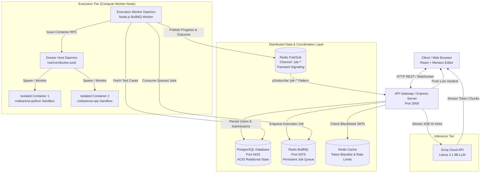

# 📚 CodeArena: Comprehensive Distributed Systems Textbook & Implementation Guide
### *From 1st Principles to Production Architecture (Mapping to B.Tech Curriculum)*

---

## 📑 Master Table of Contents
1. [Executive Overview & System Architecture](#1-executive-overview--system-architecture)
2. [End-to-End System Execution Lifecycles](#2-end-to-end-system-execution-lifecycles)
3. [UNIT I: Introduction & Distributed Computing Models](#unit-i-introduction--distributed-computing-models)
   - [1.1 1st Principles: Definition of a Distributed System](#11-1st-principles-definition-of-a-distributed-system)
   - [1.2 Core Goals of Distributed Systems](#12-core-goals-of-distributed-systems)
   - [1.3 Distributed Computing Classification](#13-distributed-computing-classification)
   - [1.4 Distributed Architectural Styles](#14-distributed-architectural-styles)
   - [1.5 Fundamental Design Issues in Distributed Systems](#15-fundamental-design-issues-in-distributed-systems)
   - [1.6 The Concept and Role of Middleware](#16-the-concept-and-role-of-middleware)
   - [1.7 Virtualization in Distributed Systems (Self Study)](#17-virtualization-in-distributed-systems-self-study)
4. [UNIT II: Communication Models & Protocols](#unit-ii-communication-models--protocols)
   - [2.1 1st Principles: Foundations of Inter-Process Communication](#21-1st-principles-foundations-of-inter-process-communication)
   - [2.2 Synchronous vs Asynchronous Communication](#22-synchronous-vs-asynchronous-communication)
   - [2.3 Transient vs Persistent Communication](#23-transient-vs-persistent-communication)
   - [2.4 Message-Oriented Communication (MOM): Queues and Pub/Sub](#24-message-oriented-communication-mom-queues-and-pubsub)
   - [2.5 Stream-Oriented Communication (WebSockets, SSE & Multiplexing)](#25-stream-oriented-communication-websockets-sse--multiplexing)
   - [2.6 Remote Procedure Call (RPC) & Unix Domain Sockets](#26-remote-procedure-call-rpc--unix-domain-sockets)
   - [2.7 Naming, Identifiers, and Addressing (Self Study)](#27-naming-identifiers-and-addressing-self-study)
   - [2.8 Fault Tolerance in Distributed Communication (Self Study)](#28-fault-tolerance-in-distributed-communication-self-study)
5. [UNIT III: Synchronization, Clocks & Concurrency](#unit-iii-synchronization-clocks--concurrency)
   - [3.1 1st Principles: Physical Time, Drift, and Clock Skew](#31-1st-principles-physical-time-drift-and-clock-skew)
   - [3.2 Logical Clocks & Lamport's Algorithm (Deep Mathematical Dive)](#32-logical-clocks--lamports-algorithm-deep-mathematical-dive)
   - [3.3 Distributed Mutual Exclusion & Atomic Concurrency Control](#33-distributed-mutual-exclusion--atomic-concurrency-control)
   - [3.4 Consistent Global State & Distributed State Machines](#34-consistent-global-state--distributed-state-machines)
   - [3.5 Beacon Protocols & Distributed Liveness Detection](#35-beacon-protocols--distributed-liveness-detection)
   - [3.6 Distributed Deadlock Prevention (Self Study - Knapp's Classification)](#36-distributed-deadlock-prevention-self-study---knapps-classification)
6. [UNIT IV: Emerging Distributed Paradigms & Cloud Systems](#unit-iv-emerging-distributed-paradigms--cloud-systems)
   - [4.1 Distributed Web-Based Systems & Stateless Gateway Patterns](#41-distributed-web-based-systems--stateless-gateway-patterns)
   - [4.2 Serverless Computing & Ephemeral Micro-Sandboxes (FaaS Model)](#42-serverless-computing--ephemeral-micro-sandboxes-faas-model)
   - [4.3 Distributed File Systems & Volume Isolation](#43-distributed-file-systems--volume-isolation)
   - [4.4 Cloud Infrastructure Case Studies: AWS & Container Orchestration](#44-cloud-infrastructure-case-studies-aws--container-orchestration)
   - [4.5 Trade-offs in Modern Distributed Databases: The CAP Theorem (Self Study)](#45-trade-offs-in-modern-distributed-databases-the-cap-theorem-self-study)
7. [Mapping to Suggested Lab Assignments](#7-mapping-to-suggested-lab-assignments)
8. [Comprehensive Implementation Scorecard](#8-comprehensive-implementation-scorecard)
9. [Master Viva & Oral Examination Guide (Top 15 Technical Q&A)](#9-master-viva--oral-examination-guide-top-15-technical-qa)

---

## 1. Executive Overview & System Architecture

CodeArena is a **distributed online judge, compilation pipeline, and sandboxed code execution platform** modeled after industrial systems like LeetCode, HackerRank, and Judge0. 

### High-Level Distributed Topology



---

## 2. End-to-End System Execution Lifecycles

### 2.1 The Asynchronous Evaluation Lifecycle (`POST /execute`)
1. **Submission Dispatch:** User clicks "Submit". The browser increments its local Lamport Clock ($L_{\text{client}} = L_{\text{client}} + 1$) and issues `POST /execute` with `{ code, language, problemId, lamportClock }`.
2. **Gateway Ingestion:** The Express API Gateway synchronizes its Lamport Clock ($L_{\text{server}} = \max(L_{\text{server}}, L_{\text{client}}) + 1$), inserts a record into PostgreSQL with status `'pending'`, pushes the payload to the BullMQ Redis queue `code-submission`, and returns `{ jobId, submissionId, status: 'pending', lamportClock }`.
3. **Channel Subscription:** The client joins the Socket.IO room `job-<jobId>`.
4. **Worker Dequeue:** An autonomous worker instance consumes the job, synchronizes its clock ($L_{\text{worker}} = \max(L_{\text{worker}}, L_{\text{server}}) + 1$), marks the database record as `'running'`, and publishes a `running` notification to Redis Pub/Sub.
5. **Sandboxed Execution:** The worker fetches test cases from PostgreSQL and invokes the local Docker daemon over `/var/run/docker.sock`, spawning ephemeral containers with 256MB RAM and 50% CPU caps.
6. **Verdict & Clock Advancement:** The worker advances its clock upon test completion ($L_{\text{worker}} = L_{\text{worker}} + 1$), writes the outcome to PostgreSQL, and publishes the final verdict payload to Redis channel `job-<jobId>`.
7. **Gateway Relay & Client Display:** The API Gateway receives the Redis message, updates its clock ($L_{\text{server}} = \max(L_{\text{server}}, L_{\text{worker}}) + 1$), and emits `job-result` to the WebSocket room. The client receives the message, advances $L_{\text{client}}$, and visualizes the causal timeline in the UI.

---

## UNIT I: Introduction & Distributed Computing Models

### 1.1 1st Principles: Definition of a Distributed System
* **Theoretical Foundation:** A distributed system is a collection of autonomous computing entities that communicate over a network and coordinate their actions by passing messages, appearing to users as a single coherent system (Tanenbaum & Van Steen). As Leslie Lamport famously noted: *"A distributed system is one in which the failure of a computer you didn't even know existed can render your own computer unusable."*
* **Core Characteristics:**
  1. *Lack of Shared Memory:* Nodes communicate exclusively through message passing over network channels.
  2. *Lack of a Global Clock:* Processes do not share a common physical clock; each possesses its own local crystal oscillator.
  3. *Independent Failures:* One component may crash or stall while others continue normal operation.
* **CodeArena Implementation:**
  - CodeArena consists of at least five independent processes: Browser Client, Express Gateway, Redis In-Memory Broker, PostgreSQL Database, and Execution Worker Daemon.
  - No node shares memory with another. The Worker running in container space communicates with the API server via Redis over TCP sockets (`6379`), and the client communicates with the server via HTTP/WebSocket (`3000`).

---

### 1.2 Core Goals of Distributed Systems

#### Goal 1: Resource Sharing
* **1st Principles:** Scarce, expensive, or high-performance resources (hardware compute, specialized compilers, databases) must be pooled and made available to multiple users without requiring each client to run local heavy software.
* **Failure of Naive Approach:** If each user ran compilers locally, code evaluation could not be standardized, malicious users could alter test cases, and mobile/web clients without native compilers could not participate.
* **CodeArena Implementation:**
  - **Where:** [backend/docker-compose.yml:L1-84](file:///c:/Users/HP/Desktop/DS/CodeArena/backend/docker-compose.yml#L1-L84) & [executor/db.js:L3-12](file:///c:/Users/HP/Desktop/DS/CodeArena/executor/db.js#L3-L12).
  - Compute engines (GCC 12, Python 3.11 runtimes), persistent database connections (`Pool({ max: 20 })`), and Redis job queues are pooled centrally.

#### Goal 2: Fault Isolation & Independent Failures
* **1st Principles:** In a robust distributed system, the failure of a subcomponent must be isolated to prevent catastrophic system-wide failure (blast-radius minimization).
* **Failure of Naive Approach:** Executing untrusted user code in the main web server process via Node's `eval()` or `child_process.exec()` means an infinite loop (`while(1){}`), segmentation fault, or memory bomb (`[0] * 10**9`) will crash the entire API server, denying service to all other users.
* **CodeArena Implementation:**
  - **Where:** [executor/executor.js:L47-125](file:///c:/Users/HP/Desktop/DS/CodeArena/executor/executor.js#L47-L125).
  - Untrusted code is isolated inside an ephemeral Docker container. If user code crashes, only that individual container is terminated by an active watchdog timer (`setTimeout(..., 5000)`), while the Worker daemon, PostgreSQL, and Express server remain completely unaffected.

#### Goal 3: Openness & Interoperability
* **1st Principles:** Openness is the property by which an application can be extended and made interoperable through standardized, vendor-neutral protocols and well-defined Interface Definition Languages (IDLs).
* **CodeArena Implementation:**
  - **Where:** [executor/server.js:L11-15](file:///c:/Users/HP/Desktop/DS/CodeArena/executor/server.js#L11-L15) & [frontend/src/api/axios.js:L1-9](file:///c:/Users/HP/Desktop/DS/CodeArena/frontend/src/api/axios.js#L1-L9).
  - Communication is strictly formalized around standard JSON payloads over HTTP/1.1 REST endpoints and RFC 6455 WebSockets, enabling any arbitrary client (CLI, mobile app, React web) to submit code without modifying backend internals.

#### Goal 4: Scalability
* **1st Principles:** Scalability measures a system's ability to handle increasing workload by adding resources.
  - *Vertical Scalability (Scaling Up):* Adding more CPU/RAM to a single machine (bounded by hardware limits and prohibitive cost).
  - *Horizontal Scalability (Scaling Out):* Adding more nodes (machines/processes) to the network.
* **CodeArena Implementation:**
  - **Where:** [executor/worker.js:L24-117](file:///c:/Users/HP/Desktop/DS/CodeArena/executor/worker.js#L24-L117) & [backend/docker-compose.yml:L35-53](file:///c:/Users/HP/Desktop/DS/CodeArena/backend/docker-compose.yml#L35-L53).
  - The worker process is entirely decoupled from the web server. Operators can scale compute horizontally simply by running `docker compose up --scale worker=4`, allowing four parallel workers to consume from the same Redis queue.

---

### 1.3 Distributed Computing Classification
* **1st Principles:** Distributed systems are traditionally divided into:
  1. *Distributed Computing Systems:* High-performance computing, clusters, and grid systems focused on computational throughput.
  2. *Distributed Information Systems:* Transactional enterprise systems coordinating multiple databases (e.g. Banking, ERP).
  3. *Distributed Pervasive Systems:* IoT and mobile wireless networks.
* **CodeArena Implementation:**
  - CodeArena represents a **Distributed Computing Cluster**: It implements a Master-Worker compute cluster dedicated to scheduling, executing, and monitoring discrete CPU-bound computational jobs across sandboxed nodes.

---

### 1.4 Distributed Architectural Styles
* **1st Principles:** Distributed software architecture defines how components are instantiated and interact:
  1. *Layered (Multi-Tier) Architecture:* Components are organized hierarchically; each layer provides services to the layer above.
  2. *Object-Based Architecture:* Objects communicate via Remote Method Invocation (RMI).
  3. *Event-Based / Publish-Subscribe Architecture:* Decoupled components publish events without knowing the recipients.
  4. *Shared Data-Space (Blackboard) Architecture:* Processes communicate indirectly via a shared persistent repository.
* **CodeArena Implementation:**
  - **Multi-Tier Layered Architecture:**
    - *Tier 1 (Presentation):* React SPA with Monaco Editor.
    - *Tier 2 (Gateway):* Express.js HTTP/WebSocket server.
    - *Tier 3 (Message/Broker Middleware):* Redis BullMQ & Pub/Sub.
    - *Tier 4 (Compute/Worker):* Node.js worker + Docker Engine.
    - *Tier 5 (Data Storage):* PostgreSQL relational store.
  - **Producer-Consumer / Master-Worker:**
    - The API Gateway acts as the **Producer** (enqueuing jobs via `submissionQueue.add`).
    - The Worker pool acts as **Consumers** (processing jobs via `new Worker('code-submission', ...)`).

---

### 1.5 Fundamental Design Issues in Distributed Systems
1. **Heterogeneity:**
   - *Problem:* Systems must span different operating systems, hardware architectures, programming languages, and network protocols.
   - *CodeArena Solution:* [executor/executor.js:L5-31](file:///c:/Users/HP/Desktop/DS/CodeArena/executor/executor.js#L5-L31) defines `LANGUAGE_CONFIG`, harmonizing execution across Python (interpreted), C++ (compiled via GCC), Node.js (JavaScript V8), and PostgreSQL (relational engine).
2. **Concurrency:**
   - *Problem:* Multiple clients submit code at the exact same millisecond, risking race conditions on databases and worker queues.
   - *CodeArena Solution:* Managed via Redis single-threaded atomic queue operations and PostgreSQL transactional serializability.
3. **Distribution Transparency:**
   - *Location Transparency:* Clients do not need to know which worker machine executes their code.
   - *Access Transparency:* Identical JSON REST calls access resources regardless of underlying OS.

---

### 1.6 The Concept and Role of Middleware
* **1st Principles:** Middleware is a logical software layer residing between the operating system/network stack and distributed applications. Its objective is to provide **distribution transparency**—hiding the complexities of network sockets, packet marshaling, connection retries, and operating system variations.
```
+-------------------------------------------------------------+
|              Applications (React Client / Worker)           |
+-------------------------------------------------------------+
|    MIDDLEWARE LAYER (BullMQ, Redis, Socket.IO, Dockerode)    |
+-------------------------------------------------------------+
|          Operating System & Network (Linux, TCP/IP)         |
+-------------------------------------------------------------+
```
* **CodeArena Implementation:**
  1. **BullMQ / Redis:** Acts as Message-Oriented Middleware (MOM), handling queue persistence, retry schedules, and atomic job distribution ([executor/queue.js](file:///c:/Users/HP/Desktop/DS/CodeArena/executor/queue.js)).
  2. **Socket.IO:** Acts as Communication Middleware, providing connection multiplexing, automatic fallback from WebSockets to HTTP long-polling, and heartbeat mechanisms ([executor/server.js](file:///c:/Users/HP/Desktop/DS/CodeArena/executor/server.js)).

---

### 1.7 Virtualization in Distributed Systems (Self Study)
* **1st Principles:** Virtualization decouples software from physical hardware.
  - *Hardware-Level Virtualization (Hypervisors / Type-1 & Type-2 VMs):* Emulates an entire virtual motherboard, CPU, and BIOS. Full guest OS kernel booted. High startup latency (20–40 seconds), large memory footprint (1–4 GB).
  - *OS-Level Virtualization (Containers):* Multiple isolated user-spaces share the single host Linux kernel. Achieved via Linux **Namespaces** (PID, Mount, Net, IPC) and **Control Groups (cgroups)**. Near-zero startup latency (<300ms) with minimal memory overhead.
* **CodeArena Implementation:**
  - **Where:** [executor/executor.js:L58-64](file:///c:/Users/HP/Desktop/DS/CodeArena/executor/executor.js#L58-L64) & [backend/sandboxes/python/Dockerfile](file:///c:/Users/HP/Desktop/DS/CodeArena/backend/sandboxes/python/Dockerfile).
  - CodeArena leverages OS-level container virtualization to spin up disposable micro-sandboxes:
    - `Memory: 256 * 1024 * 1024` (256MB RAM cap via `memory` cgroup).
    - `MemorySwap: 256 * 1024 * 1024` (Swap disabled to prevent disk thrashing).
    - `CpuQuota: 50000` (50% single CPU core limit via `cpu.cfs_quota_us`).
    - `NetworkMode: 'none'` (Network namespace detached; air-gapped from internet).
    - `USER sandbox_user` (Runs as unprivileged UID 1000 to prevent root escalation).

---

## UNIT II: Communication Models & Protocols

### 2.1 1st Principles: Foundations of Inter-Process Communication
* **Theoretical Foundation:** In the absence of shared memory, distributed processes must coordinate through **message passing** across network interfaces. The basic primitives are `send(destination, message)` and `receive(source, message)`.
* **Communication Paradigms Matrix:**
  | Dimension | Model A | Model B |
  | :--- | :--- | :--- |
  | **Synchronization** | **Synchronous:** Sender blocks until reply arrives. | **Asynchronous:** Sender continues immediately after dispatch. |
  | **Durability** | **Persistent:** Message stored until recipient is ready. | **Transient:** Message dropped if recipient is offline. |
  | **Directionality** | **Unidirectional:** One-way data flow (e.g. SSE). | **Bidirectional:** Full-duplex interactive stream (WebSockets). |

---

### 2.2 Synchronous vs Asynchronous Communication
* **1st Principles:**
  - *Synchronous Communication:* The calling thread suspends execution awaiting the remote party's response. This introduces tight temporal coupling.
  - *Asynchronous Communication:* The calling thread dispatches the message into a local buffer or intermediary broker and resumes immediately. A correlation token is returned for later reconciliation.
* **CodeArena Implementation:**
  - **Synchronous (`POST /run`):** [executor/server.js:L114-138](file:///c:/Users/HP/Desktop/DS/CodeArena/executor/server.js#L114-L138). Executes immediately via `await runOnce(...)` and blocks the HTTP request until the container finishes. Suitable only for quick single-input scripts.
  - **Asynchronous (`POST /execute`):** [executor/server.js:L140-205](file:///c:/Users/HP/Desktop/DS/CodeArena/executor/server.js#L140-L205). Enqueues the job into Redis BullMQ and returns in `< 10ms` with `{ jobId, status: 'pending' }`. The execution occurs out-of-band on a worker.

---

### 2.3 Transient vs Persistent Communication
* **1st Principles:**
  - *Transient Communication:* A message is stored only as long as both sending and receiving applications are executing and actively connected (e.g. standard UDP, raw TCP, WebSockets). If the receiver crashes, the message is permanently lost.
  - *Persistent Communication:* A message is stored in durable intermediate storage (disk-backed queue) until delivered to the recipient.
* **CodeArena Implementation:**
  - **Persistent:** BullMQ submissions in Redis. Backed by Redis disk snapshots (`redis_data:/data`). If all worker nodes are shut down, jobs remain queued safely and resume when workers restart.
  - **Transient:** Redis Pub/Sub channels (`job-*`) and Socket.IO events. These exist purely in RAM; if the client closes the browser tab before the verdict arrives, the transient UI notification simply evaporates.

---

### 2.4 Message-Oriented Communication (MOM): Queues and Pub/Sub
* **1st Principles:** Message-Oriented Middleware (MOM) provides asynchronous communication through message queuing and publish-subscribe patterns.
  1. **Point-to-Point Queue:** Exactly one consumer receives each message. Provides load balancing across worker pools.
  2. **Publish-Subscribe (Pub/Sub):** A publisher emits a message to a topic/channel; all active subscribers receive a copy.
* **CodeArena Implementation:**
  - **Point-to-Point Queue:** [executor/queue.js](file:///c:/Users/HP/Desktop/DS/CodeArena/executor/queue.js) defines `submissionQueue` over Redis. Multiple workers compete to pull jobs; BullMQ ensures a job is leased to only one worker at a time.
  - **Publish-Subscribe:** [executor/worker.js:L42-50, L94-108](file:///c:/Users/HP/Desktop/DS/CodeArena/executor/worker.js#L42-L50) & [executor/server.js:L68-80](file:///c:/Users/HP/Desktop/DS/CodeArena/executor/server.js#L68-L80). Workers publish verdicts to `job-${job.id}`. The API server subscribes via pattern `pSubscribe('job-*')` and relays to the correct client room.

---

### 2.5 Stream-Oriented Communication (WebSockets, SSE & Multiplexing)
* **1st Principles:** Traditional HTTP is a stateless request-response protocol over transient TCP connections. Stream-oriented communication maintains an established channel for continuous, sequence-dependent data transmission.
* **CodeArena Implementation:**
  1. **Full-Duplex WebSockets (Socket.IO):**
     - Persistent TCP connection negotiated via an initial HTTP upgrade handshake.
     - Enables the server to push verdict updates (`running`, `accepted`) with zero polling overhead ([executor/server.js:L20-26, L85-97](file:///c:/Users/HP/Desktop/DS/CodeArena/executor/server.js#L20-L26)).
  2. **Server-Sent Events (SSE):**
     - Implemented in `/analyze` ([executor/server.js:L335-360](file:///c:/Users/HP/Desktop/DS/CodeArena/executor/server.js#L335-L360)).
     - Uses HTTP chunked transfer encoding (`Content-Type: text/event-stream`) to stream LLM tokens from Groq API to the browser as they are generated.
  3. **Docker Multiplexed Stream Frame Parsing:**
     - When connecting to Docker's raw stream without a TTY, Docker multiplexes stdout and stderr into a single binary stream with an **8-byte frame header**:
       - Byte 0: Stream type (`1` = stdout, `2` = stderr).
       - Bytes 1–3: Reserved padding zeroes.
       - Bytes 4–7: 32-bit big-endian unsigned integer indicating payload frame size ($N$).
     - Implemented in [executor/executor.js:L170-197](file:///c:/Users/HP/Desktop/DS/CodeArena/executor/executor.js#L170-L197) (`cleanDockerLogs`) to unpack binary frames into clean text.

---

### 2.6 Remote Procedure Call (RPC) & Unix Domain Sockets
* **1st Principles:** Remote Procedure Call (Birrell & Nelson, 1984) allows a program to execute a subroutine on a remote address space without the programmer explicitly coding network details. The client calls a **stub**, which marshals arguments into a network message; the remote **skeleton** unmarshals arguments and calls the actual procedure.
* **CodeArena Implementation:**
  - **Where:** [executor/executor.js:L1-2, L52-92](file:///c:/Users/HP/Desktop/DS/CodeArena/executor/executor.js#L1-L2).
  - The worker process invokes Docker daemon operations (`createContainer`, `start`, `kill`, `logs`) over the **Unix Domain Socket** `/var/run/docker.sock`. Dockerode acts as the client stub, translating JavaScript function calls into RESTful RPC commands transmitted across the socket boundary.

---

### 2.7 Naming, Identifiers, and Addressing (Self Study)
* **1st Principles:**
  - *Name:* What a human or system uses to refer to an entity.
  - *Address:* Where the entity is located in the network topology (e.g. `127.0.0.1:3000`).
  - *Identifier:* An unforgeable, globally unique token that refers to at most one entity throughout its existence.
* **CodeArena Implementation:**
  - **Entity Identifiers:** Relational integer sequences for users (`users.id`) and submissions (`submissions.id`).
  - **Distributed Task UUIDs:** BullMQ generates 128-bit unique job identifiers (`job.id`) for distributed tracking.
  - **Logical Topic Namespaces:** Compound strings (`job-${job.id}`) identifying transient Pub/Sub channels and Socket.IO rooms.
  - **Network Service Discovery:** Docker Compose internal DNS resolves symbolic hostnames (`redis`, `postgres`) into private IP addresses.

---

### 2.8 Fault Tolerance in Distributed Communication (Self Study)
* **1st Principles:** Distributed networks experience transient packet loss, server restarts, and latency spikes. Resilient systems implement:
  1. *Exponential Backoff:* Reattempting operations with geometrically increasing delay intervals to prevent stampeding herd problems:
     $$\text{Delay}(a) = \text{InitialDelay} \times 2^{a-1}$$
  2. *Graceful Termination (Lease Cleanup):* Intercepting OS termination signals (`SIGTERM`) to flush buffers and release network ports.
* **CodeArena Implementation:**
  - **Where:** [executor/queue.js:L13-17](file:///c:/Users/HP/Desktop/DS/CodeArena/executor/queue.js#L13-L17) (`attempts: 3`, `backoff: { type: 'exponential', delay: 1000 }`) & [executor/db.js:L21-27](file:///c:/Users/HP/Desktop/DS/CodeArena/executor/db.js#L21-L27) (`process.on('SIGTERM', ...)`).

---

## UNIT III: Synchronization, Clocks & Concurrency

### 3.1 1st Principles: Physical Time, Drift, and Clock Skew
* **Theoretical Foundation:** In a distributed system, each machine possesses an independent quartz oscillator. Due to temperature fluctuations and manufacturing imperfections, crystal oscillators drift:
  $$\frac{dC}{dt} \neq 1$$
  - *Clock Drift:* The rate difference between a clock and true reference time.
  - *Clock Skew:* The absolute difference in time readings between two clocks at a given instant ($|C_A(t) - C_B(t)| > 0$).
* **Why Physical Clocks Fail for Distributed Event Ordering:**
  Suppose Client A submits code at timestamp $T = 100$, and Server B logs the receipt at local timestamp $T = 95$ due to negative clock skew. The system would record the effect occurring *before* the cause! Hence, distributed systems cannot rely solely on physical wall clocks for causal consistency.
* **CodeArena Implementation:**
  - CodeArena uses physical time only for measuring relative durations:
    - Interval elapsed time: `Date.now() - startTime` in [executor.js](file:///c:/Users/HP/Desktop/DS/CodeArena/executor/executor.js#L94).
    - Database audit timestamps: PostgreSQL `NOW()` in [server.js](file:///c:/Users/HP/Desktop/DS/CodeArena/executor/server.js#L160).
  - For event ordering across independent tiers, CodeArena implements **Lamport Logical Clocks**.

---

### 3.2 Logical Clocks & Lamport's Algorithm (Deep Mathematical Dive)

#### 1st Principles & The Happened-Before Relation ($\rightarrow$)
Introduced by Leslie Lamport in his seminal 1978 paper (*"Time, Clocks, and the Ordering of Events in a Distributed System"*), logical clocks establish an unambiguous partial ordering based on **causality**, not physical time.

The **Happened-Before relation** ($a \rightarrow b$) is defined by three rules:
1. If events $a$ and $b$ occur within the same process, and $a$ occurs before $b$, then $a \rightarrow b$.
2. If event $a$ is the sending of a message by one process, and event $b$ is the receipt of that same message by another process, then $a \rightarrow b$.
3. If $a \rightarrow b$ and $b \rightarrow c$, then $a \rightarrow c$ (Transitivity).
4. If neither $a \rightarrow b$ nor $b \rightarrow a$, then events $a$ and $b$ are **concurrent** ($a \parallel b$).

#### The Clock Condition
For any two events $a$ and $b$:
$$\text{If } a \rightarrow b \implies L(a) < L(b)$$

#### Lamport's Two Implementation Rules
* **Rule 1 (Internal Events & Pre-Send):** Before process $P_i$ executes an event or sends a message $m$, it increments its local clock:
  $$L_i = L_i + 1$$
  It attaches $L_i$ to the message: $(m, L_i)$.
* **Rule 2 (Message Reception):** When process $P_j$ receives message $(m, L_{\text{msg}})$, it updates its local clock before executing the receive event:
  $$L_j = \max(L_j, L_{\text{msg}}) + 1$$

---

#### CodeArena Implementation of Lamport's Algorithm

CodeArena implements Lamport Logical Clocks across all distributed tiers:

```
[Client (Browser)]          [API Gateway (Server)]         [Worker Daemon]
       |                              |                           |
 (1) L_c = L_c + 1                    |                           |
  Submit Code (L=1) ----------------> |                           |
                                (2) L_s = max(L_s, 1) + 1 = 2     |
                                     Enqueue to BullMQ ---------> |
                                                            (3) L_w = max(L_w, 2) + 1 = 3
                                                                 Job Picked from Queue
                                                            (4) L_w = L_w + 1 = 4
                                                                 Sandbox Execution Started
                                                            (5) L_w = L_w + 1 = 5
                                                                 Execution Completed
                                      <-------------------------- Publish to Redis Pub/Sub
                                (6) L_s = max(L_s, 5) + 1 = 6
                                     Websocket Relay
       <----------------------- Emit to Socket Room
 (7) L_c = max(L_c, 6) + 1 = 7
  Result Rendered in UI
```

##### 1. Client Node: [frontend/src/pages/Editor.jsx](file:///c:/Users/HP/Desktop/DS/CodeArena/frontend/src/pages/Editor.jsx)
- **State Initialization:**
  ```javascript
  const [clientLamportClock, setClientLamportClock] = useState(0);
  const [lamportTimeline, setLamportTimeline] = useState([]);
  ```
- **Rule 1 (Pre-Send):**
  ```javascript
  // L_client = L_client + 1 before dispatching HTTP POST
  const nextClock = clientLamportClock + 1;
  setClientLamportClock(nextClock);
  await api.post('/execute', { code, language, problemId, lamportClock: nextClock });
  ```
- **Rule 2 (Result Reception):**
  ```javascript
  socketRef.current.on('job-result', (data) => {
      if (data.lamportClock !== undefined) {
          setClientLamportClock(prev => Math.max(prev, Number(data.lamportClock)) + 1);
          setLamportTimeline(data.lamportTimeline);
      }
  });
  ```

##### 2. API Gateway: [executor/server.js](file:///c:/Users/HP/Desktop/DS/CodeArena/executor/server.js)
- **Rule 2 on Ingestion (`/execute`):**
  ```javascript
  let serverLamportClock = 0;
  const clientClock = parseInt(req.body.lamportClock, 10) || 0;
  serverLamportClock = Math.max(serverLamportClock, clientClock) + 1;

  await submissionQueue.add('execute', {
      ...,
      lamportClock: serverLamportClock,
      lamportTimeline: [
          { node: 'Client (Browser)', event: 'Submit Code', clock: clientClock },
          { node: 'API Gateway', event: 'Job Queued in Redis', clock: serverLamportClock }
      ]
  });
  ```
- **Rule 2 on Pub/Sub Message Receipt:**
  ```javascript
  subscriber.pSubscribe('job-*', (message, channel) => {
      const result = JSON.parse(message);
      serverLamportClock = Math.max(serverLamportClock, result.lamportClock || 0) + 1;
      result.lamportClock = serverLamportClock;
      result.lamportTimeline.push({
          node: 'API Gateway', event: 'Websocket Relay', clock: serverLamportClock
      });
      io.to(`job-${jobId}`).emit('job-result', result);
  });
  ```

##### 3. Worker Node: [executor/worker.js](file:///c:/Users/HP/Desktop/DS/CodeArena/executor/worker.js)
- **Rule 2 on Job Pickup:**
  ```javascript
  let workerLamportClock = 0;
  workerLamportClock = Math.max(workerLamportClock, job.data.lamportClock || 0) + 1;
  ```
- **Rule 1 on Container Execution Completion:**
  ```javascript
  workerLamportClock = workerLamportClock + 1;
  timeline.push({ node: 'Worker Daemon', event: 'Sandbox Execution Completed', clock: workerLamportClock });
  await publisher.publish(`job-${job.id}`, JSON.stringify({ ..., lamportClock: workerLamportClock }));
  ```

---

### 3.3 Distributed Mutual Exclusion & Atomic Concurrency Control
* **1st Principles:** In distributed systems lacking shared memory, multiple processes must coordinate access to shared critical resources (e.g. database rows, unexecuted jobs) without race conditions.
* **CodeArena Implementation:**
  - **Queue-Level Mutual Exclusion:** BullMQ utilizes **atomic Redis Lua scripts** that execute within Redis's single-threaded event loop. When a worker pops a job, Redis evaluates the lock atomically, guaranteeing that no two competing workers can lease the same submission simultaneously.
  - **Database ACID Serialization:** PostgreSQL row-level locks protect user registrations and submission status transitions from dirty reads and lost updates.

---

### 3.4 Consistent Global State & Distributed State Machines
* **1st Principles:** A distributed algorithm moves a system through a sequence of consistent global states. A global state consists of the local state of each process plus the messages in transit across communication channels.
* **CodeArena State Machine:**
  $$\text{PENDING (Server/DB)} \xrightarrow{\text{Enqueue}} \text{QUEUED (Redis)} \xrightarrow{\text{Lease}} \text{RUNNING (Worker/Docker)} \xrightarrow{\text{Verdict}} \text{ACCEPTED / WRONG\_ANSWER (DB/PubSub)}$$
* **Fault Handling:** If a worker node crashes while a job is in the `RUNNING` state, BullMQ's stall detector detects the expired lease lock and transitions the job back to `QUEUED`, preventing orphaned submissions.

---

### 3.5 Beacon Protocols & Distributed Liveness Detection
* **1st Principles:** In asynchronous distributed networks, an algorithm cannot distinguish between a process that has crashed and one that is simply executing slowly. Periodic **Heartbeat (Beacon) protocols** are used to provide probabilistic liveness guarantees.
* **CodeArena Implementation:**
  - **WebSocket Ping/Pong:** Socket.IO continuously sends periodic heartbeat beacons between browser and server. If the client drops off (e.g. closing browser tab), the server detects heartbeat expiration and releases socket room resources ([server.js:L94](file:///c:/Users/HP/Desktop/DS/CodeArena/executor/server.js#L94)).
  - **Worker Lock Renewal Leases:** While executing code, BullMQ periodically touches lock keys in Redis to beacon active liveness.

---

### 3.6 Distributed Deadlock Prevention (Self Study - Knapp's Classification)
* **1st Principles:** A distributed deadlock occurs when two or more processes are waiting for resources held by each other, forming a circular wait graph:
  $$P_1 \rightarrow P_2 \rightarrow \dots \rightarrow P_1$$
  Knapp's classification categorizes deadlock detection algorithms into:
  - *Path-pushing algorithms*
  - *Edge-chasing algorithms* (Chandy-Misra-Haas)
  - *Diffusing computations*
  - *Global state detection*
* **CodeArena Implementation:**
  - Rather than incurring the high message overhead of runtime distributed deadlock detection, CodeArena implements **Deadlock Prevention by Design** through **Strict Hierarchical Acyclic Resource Ordering**:
    $$\text{Client} \longrightarrow \text{Express Gateway} \longrightarrow \text{Redis Queue} \longrightarrow \text{Worker Node} \longrightarrow \text{Docker Engine}$$
  - Because resources are requested strictly downward in a Directed Acyclic Graph (DAG), a circular wait condition is mathematically impossible ($E(G)$ contains no cycles).

---

## UNIT IV: Emerging Distributed Paradigms & Cloud Systems

### 4.1 Distributed Web-Based Systems & Stateless Gateway Patterns
* **1st Principles:** High-concurrency web systems must externalize state away from the application compute servers so that any arbitrary server replica can handle any incoming request.
* **CodeArena Implementation:**
  - The Express.js backend is completely **stateless**.
  - User session state is encoded inside cryptographically signed **JSON Web Tokens (JWT)** stored in `httpOnly` secure cookies.
  - Instant token revocation (logout) is handled via an in-memory Redis blacklist:
    ```javascript
    await redisClient.set(`blacklist:${token}`, 'true', { EX: remainingTtl });
    ```
  - This design allows spinning up ten duplicate API server instances behind an Nginx load balancer without requiring session stickiness.

---

### 4.2 Serverless Computing & Ephemeral Micro-Sandboxes (FaaS Model)
* **1st Principles:** Function-as-a-Service (FaaS) represents the culmination of cloud compute virtualization: instead of paying for idle, resident virtual machines, compute runtimes are instantiated on-demand, execute for milliseconds, and are immediately destroyed.
* **CodeArena Implementation:**
  - **Where:** [executor/executor.js:L52-93](file:///c:/Users/HP/Desktop/DS/CodeArena/executor/executor.js#L52-L93) (`runOnce`).
  - CodeArena emulates AWS Lambda:
    1. Worker receives job.
    2. Spawns an ephemeral container (`codearena-python`).
    3. Feeds `stdin` input.
    4. Enforces a 5,000ms wall-clock ceiling.
    5. Collects stdout/stderr.
    6. Destroys the container immediately via `container.remove()`.
  - Guarantees an immutable, unpolluted environment for every single submission.

---

### 4.3 Distributed File Systems & Volume Isolation
* **1st Principles:** Container processes operate on transient, copy-on-write overlay filesystems that disappear when the container terminates. Durable state must be mounted into persistent storage volumes.
* **CodeArena Implementation:**
  - **Where:** [backend/docker-compose.yml:L60-61, L74-75, L82-84](file:///c:/Users/HP/Desktop/DS/CodeArena/backend/docker-compose.yml#L60-L61).
  - PostgreSQL mounts named volume `postgres_data` to `/var/lib/postgresql/data`.
  - Redis mounts named volume `redis_data` to `/data`.
  - Decouples storage durability from container process lifecycles.

---

### 4.4 Cloud Infrastructure Case Studies: AWS & Container Orchestration
* **1st Principles:** Modern distributed applications are packaged into declarative infrastructure blueprints and orchestrated on cloud platforms like AWS or Kubernetes.
* **CodeArena Implementation:**
  - **AWS EC2 Production Deployment:** Deployed on an AWS EC2 Ubuntu instance accessible via public IP (`15.206.170.214`).
  - **Container Orchestration Mapping (Docker Compose $\leftrightarrow$ Kubernetes):**
    | Docker Compose Service | Kubernetes Equivalent | Purpose |
    | :--- | :--- | :--- |
    | `server` | `Deployment` + `ClusterIP Service` | Stateless web gateway |
    | `worker` | `Deployment` (HPA scaled on queue depth) | Compute execution daemon |
    | `redis` | `StatefulSet` + `PersistentVolumeClaim` | In-memory queue & Pub/Sub broker |
    | `postgres` | `StatefulSet` + `PersistentVolumeClaim` | Durable relational persistence |

---

### 4.5 Trade-offs in Modern Distributed Databases: The CAP Theorem (Self Study)
* **1st Principles:** Eric Brewer's CAP Theorem states that a distributed data store can guarantee at most two of the following three properties simultaneously:
  1. **Consistency (C):** Every read receives the most recent write or an error.
  2. **Availability (A):** Every non-failing node returns a response (without guarantee that it contains the most recent write).
  3. **Partition Tolerance (P):** The system continues to operate despite arbitrary network partitions or dropped messages.
* **CodeArena Polyglot Persistence Architecture:**
  - CodeArena implements a hybrid persistence strategy balancing the CAP trade-offs:
    ```
                  CAP SPECTRUM
        [ PostgreSQL (CP/CA) ]       [ Redis (AP / In-Memory) ]
        - Strong Consistency         - High Availability & Low Latency
        - ACID Transactions          - Sub-millisecond read/write
        - Relational Integrity       - In-memory queuing & Pub/Sub
        - Users, Problems, Tests     - BullMQ Queues, Blacklist Cache
    ```
  - Using PostgreSQL alone for high-frequency pub/sub would cause disk I/O bottlenecks; using Redis alone for user accounts would compromise relational integrity and ACID durability.

---

## 7. Mapping to Suggested Lab Assignments

| Syllabus Lab Assignment | How CodeArena Demonstrates / Solves It |
| :--- | :--- |
| **Lab 1: Client–Server Program using Socket/gRPC** | Implemented via **Socket.IO WebSockets** ([server.js](file:///c:/Users/HP/Desktop/DS/CodeArena/executor/server.js) & [Editor.jsx](file:///c:/Users/HP/Desktop/DS/CodeArena/frontend/src/pages/Editor.jsx)) and inter-process RPC over **Unix Domain Sockets** (`/var/run/docker.sock`). |
| **Lab 2: Coordinator Election (Bully/Ring Algorithm)** | Theoretical comparison: CodeArena currently uses centralized Redis queue coordination. If deploying Redis Sentinel or multi-master workers, Bully/Ring algorithms elect the cluster leader. |
| **Lab 3: Deadlock Detection Algorithm** | CodeArena eliminates distributed deadlocks by construction using strict Directed Acyclic Graph (DAG) hierarchical resource ordering. |
| **Lab 4: Clock Synchronization (Lamport Algorithm)** | **Fully implemented in live code!** Implements Lamport's Rule 1 & Rule 2 across Client, Gateway, and Worker, visualizing the causal order in the Editor UI. |
| **Lab 5: Word Count using Hadoop (MapReduce)** | Theoretical comparison: CodeArena's Master-Worker queue model mirrors MapReduce task scheduling, where independent workers map code execution tasks across isolated containers. |

---

## 8. Comprehensive Implementation Scorecard

| Syllabus Unit | Core Concept | Present in CodeArena? | Concrete Implementation in Codebase |
| :--- | :--- | :---: | :--- |
| **Unit I: Introduction** | Multi-Tier Architecture | ✅ **Yes** | 5-tier architecture: Presentation, Gateway, Broker, Worker, Storage |
| | Resource Sharing | ✅ **Yes** | Pooled compute sandboxes, DB connection pool, Redis broker |
| | Fault Isolation | ✅ **Yes** | Docker containers isolate crashed user code from server/host |
| | Horizontal Scalability | ✅ **Yes** | Autonomous worker replicas scaled via `docker compose scale` |
| | Middleware | ✅ **Yes** | Redis BullMQ (Queue MOM) & Socket.IO (Event Middleware) |
| | Heterogeneity | ✅ **Yes** | Node.js, Python 3.11, GCC 12, PostgreSQL, Redis, Linux cgroups |
| | OS Virtualization (Self Study) | ✅ **Yes** | Linux cgroups, namespaces, memory caps, non-root user |
| | Distributed Multimedia | ❌ **No** | Text/code execution only; no audio/video streams |
| **Unit II: Communication** | Synchronous vs Asynchronous | ✅ **Yes** | Synchronous `POST /run` vs Asynchronous `POST /execute` |
| | Persistent vs Transient | ✅ **Yes** | Persistent BullMQ Redis queues vs Transient Pub/Sub & WebSockets |
| | Message Queuing (MOM) | ✅ **Yes** | BullMQ with exponential backoff retries and single-worker delivery |
| | Publish-Subscribe (Pub/Sub) | ✅ **Yes** | Redis Pub/Sub (`pSubscribe('job-*')`) for decoupled event dispatch |
| | Stream Communication | ✅ **Yes** | Full-duplex WebSockets + Server-Sent Events (SSE) AI streaming |
| | RPC & Socket IPC | ✅ **Yes** | Unix Domain Socket RPC over `/var/run/docker.sock` via Dockerode |
| | Naming & Addresses (Self Study) | ✅ **Yes** | Monotonic IDs, BullMQ UUIDs, compound socket rooms, Docker DNS |
| | Fault Tolerance (Self Study) | ✅ **Yes** | Exponential backoff retries (3 attempts), automatic socket reconnect |
| | P2P Messaging / WebRTC | ❌ **No** | Centralized client-broker-worker topology; no P2P mesh |
| **Unit III: Synchronization** | Physical Time & Clock Skew | ✅ **Yes** | Demonstrates interval timing (`Date.now()`) and clock drift limits |
| | Lamport's Logical Clocks | ✅ **Yes** | **Fully implemented!** Rule 1 & Rule 2 across all nodes with live UI |
| | Distributed Mutual Exclusion | ✅ **Yes** | Redis atomic Lua scripts for queue locks + PostgreSQL row locks |
| | Global State Progression | ✅ **Yes** | Deterministic state machine: `pending` $\rightarrow$ `running` $\rightarrow$ `accepted` |
| | Beacon Protocol (Liveness) | ✅ **Yes** | Socket.IO ping/pong heartbeats + BullMQ worker lease renewals |
| | Distributed Deadlock Prevention | ✅ **By Design** | Hierarchical acyclic DAG ordering prevents circular wait |
| | Election Algorithms (Bully/Ring) | ❌ **No** | Relies on single-master Redis broker; no dynamic leader election |
| **Unit IV: Emerging Paradigms** | Distributed Web Systems | ✅ **Yes** | React SPA + stateless Express gateway + Redis token revocation |
| | Serverless Execution (FaaS) | ✅ **Yes** | On-demand ephemeral container provisioning and immediate destruction |
| | Distributed File Systems | ✅ **Yes** | Named persistent storage volumes (`redis_data`, `postgres_data`) |
| | Cloud Case Studies: AWS & K8s | ✅ **Yes** | AWS EC2 deployment + Docker Compose orchestration mapped to K8s |
| | Database Trade-offs (CAP) | ✅ **Yes** | Polyglot persistence: PostgreSQL (ACID/CP) + Redis (In-Memory/AP) |
| | Blockchain & DLT (Self Study) | ❌ **No** | Centralized database; no decentralized consensus protocol |

---

## 9. Master Viva & Oral Examination Guide (Top 15 Technical Q&A)

#### Q1: "What makes CodeArena a distributed system rather than a standard web application?"
> **Answer:** "CodeArena consists of multiple autonomous processes (React browser client, Express API gateway, Redis message broker, PostgreSQL relational store, and worker daemon) running across separate process spaces and network interfaces. They share zero physical memory and coordinate strictly through message passing (HTTP, WebSockets, Redis Pub/Sub, and Unix domain sockets). It implements core distributed systems primitives including asynchronous message queuing, fault isolation, and Lamport logical clocks."

#### Q2: "Why did you implement Lamport's Logical Clock algorithm?"
> **Answer:** "In a distributed system, physical wall clocks drift due to quartz crystal variations, creating clock skew. If Worker A and Worker B run on separate cloud machines, physical timestamps cannot reliably determine whether a submission event caused an execution event. Lamport's algorithm enforces causal partial ordering ($a \rightarrow b \implies L(a) < L(b)$) using two simple rules:
> 1. Processes increment their local clock before internal/send events ($L = L + 1$).
> 2. Receivers advance their clock to $\max(L_{\text{local}}, L_{\text{msg}}) + 1$ upon receiving a message.
> We display this causal chain live in the UI from Client ($L=1$) to Gateway ($L=2$) to Worker ($L=3$) to Execution ($L=5$) to Gateway ($L=6$) to Client ($L=7$)."

#### Q3: "Why did you decouple the Web Server from the Worker using BullMQ and Redis?"
> **Answer:** "Compiling and running untrusted code is CPU- and memory-intensive (taking 1 to 5 seconds per submission). If the web server compiled code directly, the single-threaded Node.js event loop would freeze under concurrent requests, resulting in denial of service. By placing requests into a Redis BullMQ persistent queue, the web server responds immediately ($<10\text{ms}$), buffering traffic spikes and allowing worker nodes to process submissions at a safe, controlled concurrency level."

#### Q4: "How does CodeArena implement Fault Isolation (Unit I)?"
> **Answer:** "CodeArena employs OS-level virtualization via Docker. Every user submission runs in a separate, unprivileged container with strict cgroups hardware limits (256MB RAM, 50% CPU core) and an execution watchdog timer (5 seconds). If a user writes an infinite loop or fork bomb, only that specific container is killed; the worker daemon, database, and API gateway remain completely unaffected."

#### Q5: "What is the role of Middleware in this architecture (Unit I)?"
> **Answer:** "Middleware provides distribution transparency. CodeArena uses two forms of middleware:
> 1. **Message-Oriented Middleware (BullMQ + Redis):** Abstracts distributed job queues, manages retry policies, and serializes messages.
> 2. **Real-Time Event Middleware (Socket.IO):** Abstracts raw TCP sockets, handles automatic fallback to HTTP polling, manages heartbeat pings, and multiplexes room subscriptions."

#### Q6: "Explain the difference between the synchronous and asynchronous execution flows in your system (Unit II)."
> **Answer:** "CodeArena provides two execution paths:
> 1. **Synchronous (`POST /run`):** The client makes an HTTP request and blocks while the server runs the container via `runOnce()` and returns the output immediately. Used for quick single-input testing.
> 2. **Asynchronous (`POST /execute`):** The client dispatches a submission, the gateway enqueues it in Redis and responds immediately with a correlation ID (`jobId`), and the client joins a WebSocket room. The worker executes test cases in the background and pushes the verdict via Redis Pub/Sub and WebSockets."

#### Q7: "Why did you choose WebSockets over HTTP polling for submission results (Unit II)?"
> **Answer:** "HTTP polling incurs heavy network overhead: each poll requires establishing a TCP connection, TLS handshake, and transmitting HTTP headers ($O(N)$ requests/sec per client), consuming significant server CPU. WebSockets establish a single persistent, full-duplex TCP connection, allowing the server to push verdict updates the instant execution finishes with sub-millisecond latency."

#### Q8: "How does the system communicate with the host Docker daemon (Unit II)?"
> **Answer:** "Communication is achieved via Remote Procedure Call (RPC) over the **Unix Domain Socket** `/var/run/docker.sock`. The Dockerode library acts as a client stub, marshaling JavaScript method calls (`createContainer`, `start`, `kill`) into HTTP REST commands transmitted across the socket boundary to the Docker daemon."

#### Q9: "Why is there an 8-byte header parsing function (`cleanDockerLogs`) in `executor.js`?"
> **Answer:** "When attaching to Docker container output without a pseudo-TTY (`Tty: false`), Docker multiplexes stdout and stderr into a single binary stream. Each packet has an 8-byte binary frame header (byte 0 indicates stdout vs stderr, and bytes 4–7 give the big-endian payload length). `cleanDockerLogs` parses and removes these binary headers to extract clean text output."

#### Q10: "How does CodeArena achieve Distributed Mutual Exclusion (Unit III)?"
> **Answer:** "CodeArena achieves mutual exclusion at the queue layer using **atomic Redis Lua scripts** inside BullMQ. Because Redis processes commands sequentially on a single-threaded event loop, Lua scripts execute atomically without interruption, guaranteeing that only one worker can lease and claim a given submission lock."

#### Q11: "How does CodeArena prevent Distributed Deadlocks (Unit III - Knapp's Classification)?"
> **Answer:** "CodeArena prevents deadlocks by design using **Strict Hierarchical Acyclic Resource Ordering**. The resource dependency graph is a unidirectional DAG:
> $$\text{Client} \longrightarrow \text{Gateway} \longrightarrow \text{Redis Queue} \longrightarrow \text{Worker} \longrightarrow \text{Docker}$$
> Because circular resource wait conditions ($P_1 \rightarrow P_2 \rightarrow P_1$) cannot form, distributed deadlocks are mathematically impossible, eliminating the need for runtime edge-chasing detection algorithms."

#### Q12: "How does CodeArena emulate Serverless / FaaS architectures (Unit IV)?"
> **Answer:** "CodeArena implements the core execution model of AWS Lambda: compute environments are not kept running resident. Instead, when a job arrives, an ephemeral micro-sandbox container is provisioned on demand, inputs are injected via `stdin`, an execution time limit is enforced, output is collected, and the container is immediately destroyed via `container.remove()`."

#### Q13: "Explain your database architecture in terms of the CAP Theorem (Unit IV)."
> **Answer:** "CodeArena implements **Polyglot Persistence** to balance the CAP theorem:
> 1. **PostgreSQL (CP/CA):** Prioritizes Strong Consistency and ACID transactions for user credentials, problem definitions, and verified submission outcomes.
> 2. **Redis (AP / In-Memory):** Prioritizes High Availability and sub-millisecond write throughput for transient job queues, token blacklists, and real-time Pub/Sub signaling."

#### Q14: "How does the system handle state management across multiple web server instances (Unit IV)?"
> **Answer:** "The Express API Gateway is completely stateless. Authentication session state is stored inside client-side JWT cookies. Active revoked tokens are stored in a shared Redis blacklist cache, and submission state is stored in PostgreSQL. Because no session state is held in local memory, ten API server replicas can be deployed behind an Nginx load balancer without requiring sticky sessions."

#### Q15: "Why is running CodeArena locally on Docker Desktop sufficient to demonstrate a distributed system without needing AWS?"
> **Answer:** "A distributed system is fundamentally defined by independent processes communicating over network channels without shared memory. In our local setup, the React browser, Express Gateway, Redis broker, PostgreSQL database, and Docker sandboxes run in separate memory spaces communicating over network ports (`5173`, `3000`, `6379`, `5432`) and a virtual Docker bridge network (`172.x.x.x`). The code is containerized with Docker Compose, meaning it runs identically locally as it would on AWS EC2 or Amazon ECS."
