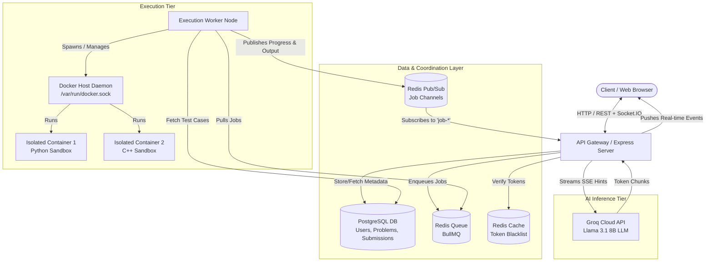
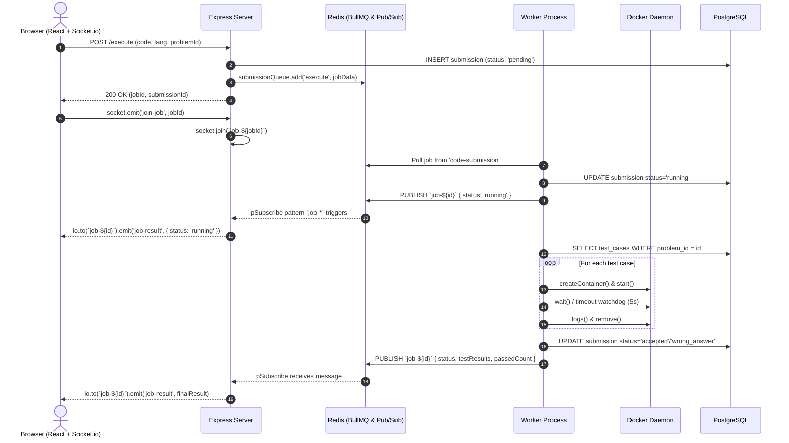

# 📚 CodeArena: Distributed Systems Architecture, Deep-Dive & Syllabus Mapping

This guide provides an end-to-end breakdown of the **CodeArena** codebase—its architecture, execution flows, design trade-offs, internal mechanics, and code snippets—followed by an exhaustive, unit-wise breakdown of **What is Implemented, Where in the Code, and Why** according to the **4 Units of the Distributed Systems (DS) Syllabus**.

---

## 📑 Table of Contents
1. [Executive Overview & High-Level Architecture](#1-executive-overview--high-level-architecture)
2. [End-to-End System Flow & Mechanics](#2-end-to-end-system-flow--mechanics)
   - [2.1 Synchronous Run Flow (`/run`)](#21-synchronous-run-flow-run)
   - [2.2 Asynchronous Queued Submission Flow (`/execute`)](#22-asynchronous-queued-submission-flow-execute)
   - [2.3 Real-Time Feedback Loop (Redis Pub/Sub + WebSockets)](#23-real-time-feedback-loop-redis-pubsub--websockets)
   - [2.4 AI Mentorship Streaming Flow (SSE)](#24-ai-mentorship-streaming-flow-sse)
3. [Key Architectural & Engineering Design Choices](#3-key-architectural--engineering-design-choices)
   - [Asynchronous Job Queue vs Direct Execution](#asynchronous-job-queue-vs-direct-execution)
   - [Sandbox Security & OS-Level Virtualization](#sandbox-security--os-level-virtualization)
   - [Docker Multiplexed Stream Protocol Parser](#docker-multiplexed-stream-protocol-parser)
   - [Hybrid Authentication: Stateless JWT + Stateful Redis Blacklist](#hybrid-authentication-stateless-jwt--stateful-redis-blacklist)
4. [Critical Code Snippets & Technical Walkthrough](#4-critical-code-snippets--technical-walkthrough)
5. [Unit-Wise Implementation Deep Dive: WHAT, WHERE & WHY](#5-unit-wise-implementation-deep-dive-what-where--why)
   - [UNIT I: Introduction & Distributed Computing Models](#unit-i-introduction--distributed-computing-models)
   - [UNIT II: Communication Models & Protocols](#unit-ii-communication-models--protocols)
   - [UNIT III: Synchronization, Clocks & Concurrency](#unit-iii-synchronization-clocks--concurrency)
   - [UNIT IV: Emerging Distributed Paradigms & Cloud Systems](#unit-iv-emerging-distributed-paradigms--cloud-systems)
6. [Unit-Wise Implementation Matrix (Scorecard)](#6-unit-wise-implementation-matrix-scorecard)
7. [Viva / Oral Exam Preparation (Top 10 Technical Questions)](#7-viva--oral-exam-preparation-top-10-technical-questions)

---

## 1. Executive Overview & High-Level Architecture

CodeArena is a **distributed online judge and sandboxed code execution platform** modeled after industrial systems like LeetCode, HackerRank, and Judge0. It allows concurrent users to compile and evaluate untrusted user code (Python, C++) against hidden and visible test suites with strict CPU, memory, and network constraints.

### Distributed Multi-Tier Topology



---

## 2. End-to-End System Flow & Mechanics

### 2.1 Synchronous Run Flow (`/run`)
Used when a user writes arbitrary code with custom input and clicks **"Run"**:
1. Frontend sends a `POST /run` HTTP request containing `{ code, language, stdin }`.
2. The server verifies the JWT cookie.
3. Instead of enqueueing, it executes immediately using `runOnce()` in [executor.js](file:///c:/Users/HP/Desktop/DS/CodeArena/executor/executor.js).
4. `runOnce()` calls Docker Engine via Dockerode, spawns an ephemeral container, feeds `stdin`, sets a 5-second watchdog timer, captures stdout/stderr, tears down the container, and returns the output synchronously to the HTTP response.

### 2.2 Asynchronous Queued Submission Flow (`/execute`)
Used when submitting a problem solution against full test suites:
1. **Submission Ingestion:** User clicks "Submit". React client issues `POST /execute` with `{ code, language, problemId }`.
2. **Database Logging:** Server persists a row in `submissions` table with status `'pending'`.
3. **Queue Enqueueing:** The job `{ submissionId, code, language, problemId, userId }` is pushed to BullMQ Redis Queue (`code-submission`).
4. **Immediate Acknowledgment:** The API responds immediately with `{ jobId, submissionId, status: 'pending' }` without waiting for execution.
5. **Channel Subscription:** Client receives `jobId` and emits Socket.IO event `join-job` with `jobId`. The socket joins room `job-<jobId>`.

### 2.3 Real-Time Feedback Loop (Redis Pub/Sub + WebSockets)


### 2.4 AI Mentorship Streaming Flow (SSE)
When tests fail, the user requests AI analysis:
1. Client calls `POST /analyze` with test case outputs and code.
2. The server queries past submission history and problem context from PostgreSQL.
3. Calls Groq API (`llama-3.1-8b-instant`) with an instructional prompt (Socratic guidance, root-cause categorization, chain-of-thought analysis).
4. Configures HTTP response headers for **Server-Sent Events (SSE)**:
   ```http
   Content-Type: text/event-stream
   Cache-Control: no-cache
   Connection: keep-alive
   ```
5. Chunks are streamed in real time (`data: {"text": "..."}\n\n`) as tokens are generated, minimizing perceived latency.

---

## 3. Key Architectural & Engineering Design Choices

### Asynchronous Job Queue vs Direct Execution
- **Problem:** Compiling and executing arbitrary C++ / Python programs takes 1-5 seconds of heavy CPU and RAM. Under concurrent traffic, running executions inside the main web server process would block the event loop or crash the host (DoS vulnerability).
- **Solution:** Decouple reception from processing. The web server acts as an ultra-fast **Producer**, placing work into a Redis-backed persistent queue. Independent **Worker** instances pull jobs based on their capacity (`concurrency: 2`). If 1,000 users submit simultaneously, requests queue safely instead of crashing the server.

### Sandbox Security & OS-Level Virtualization
Executing untrusted user code requires sandboxing at multiple operating system layers:
1. **Zero Network Access (`NetworkMode: 'none'`):** Prevents malware from contacting external Command & Control servers, port-scanning internal VPC networks, or downloading exploit payloads.
2. **Resource Bounds via cgroups:**
   - `Memory: 256MB` and `MemorySwap: 256MB`: Protects against memory bomb attacks (e.g. `[0] * 10**9`).
   - `CpuQuota: 50000` (50% of single CPU core): Throttles CPU-intensive infinite loops (e.g. `while True: pass`).
3. **Execution Watchdog (Timeout Kill):** A Node.js timeout timer forces container termination after 5,000ms if a process hangs.
4. **Least Privilege Non-Root User:** Containers run under unprivileged user `sandbox_user` (UID 1000), preventing filesystem escapes or tampering with container configuration.
5. **Disposable Ephemeral Environments:** Containers are created per test case execution and destroyed immediately after reading output logs.

### Docker Multiplexed Stream Protocol Parser
When attaching to Docker container stdout/stderr without a TTY (`Tty: false`), the Docker Engine API returns a **multiplexed binary stream**. Raw output contains an 8-byte frame header for every packet:
- Byte 0: Stream identifier (`1` for stdout, `2` for stderr).
- Bytes 1-3: Reserved zeroes.
- Bytes 4-7: 32-bit big-endian unsigned integer indicating payload frame size.

If read as raw strings, output contains corrupt unprintable characters. CodeArena implements a custom frame unpacker in [executor.js](file:///c:/Users/HP/Desktop/DS/CodeArena/executor/executor.js#L170-L197):
```javascript
function cleanDockerLogs(data) {
    const buffer = Buffer.isBuffer(data) ? data : Buffer.from(data, 'utf8');
    let output = '', i = 0;
    while (i < buffer.length) {
        if (i + 8 <= buffer.length) {
            const size = buffer.readUInt32BE(i + 4);
            i += 8;
            if (i + size <= buffer.length) {
                output += buffer.slice(i, i + size).toString('utf8');
                i += size;
            } else { break; }
        } else {
            output += buffer.slice(i).toString('utf8');
            break;
        }
    }
    return output;
}
```

### Hybrid Authentication: Stateless JWT + Stateful Redis Blacklist
- Access tokens expire in 15 minutes to preserve stateless scalability across backend nodes.
- Refresh tokens (7 days) are stored in PostgreSQL with token rotation on each refresh.
- To enable instant revocation on logout (which pure stateless JWT cannot do), the access token is written to Redis with a TTL:
  ```javascript
  await redisClient.set(`blacklist:${token}`, 'true', { EX: remainingTtl });
  ```
- The `verifyToken` middleware performs an $O(1)$ fast lookup in Redis before accepting incoming requests.

---

## 4. Critical Code Snippets & Technical Walkthrough

### 1. Job Queue Setup ([executor/queue.js](file:///c:/Users/HP/Desktop/DS/CodeArena/executor/queue.js))
Configures BullMQ connection to Redis with exponential backoff fault-tolerance and retention policies:
```javascript
const { Queue } = require('bullmq');

const connection = {
    host: process.env.REDIS_HOST || 'redis',
    port: 6379
};

const submissionQueue = new Queue('code-submission', {
    connection,
    defaultJobOptions: {
        attempts: 3,
        backoff: {
            type: 'exponential',
            delay: 1000
        },
        removeOnComplete: 100,
        removeOnFail: 50
    }
});
```

### 2. Sandbox Container Creation with Isolation ([executor/executor.js](file:///c:/Users/HP/Desktop/DS/CodeArena/executor/executor.js))
Spawns Docker containers with air-gapping and hardware ceilings:
```javascript
container = await docker.createContainer({
    Image: config.image,
    Cmd: config.getCmd(code, stdin),
    Tty: false,
    AttachStdout: true,
    AttachStderr: true,
    HostConfig: {
        Memory: 256 * 1024 * 1024,      // 256MB RAM cap
        MemorySwap: 256 * 1024 * 1024,  // Disable swap expansion
        CpuQuota: 50000,               // 50% CPU allocation
        NetworkMode: 'none',           // No network access (sandbox isolation)
        AutoRemove: false
    }
});
```

### 3. Asynchronous Worker Processing & Event Publishing ([executor/worker.js](file:///c:/Users/HP/Desktop/DS/CodeArena/executor/worker.js))
Pulls queued jobs, updates PostgreSQL, runs sandbox tests, and broadcasts results:
```javascript
const worker = new Worker('code-submission', async (job) => {
    const { submissionId, code, language, problemId } = job.data;
    
    // 1. Mark running in DB and notify
    await pool.query(`UPDATE submissions SET status = 'running' WHERE id=$1`, [submissionId]);
    await publisher.publish(`job-${job.id}`, JSON.stringify({ submissionId, status: 'running' }));

    // 2. Fetch test cases & execute in Docker
    const tcResult = await pool.query('SELECT * FROM test_cases WHERE problem_id = $1', [problemId]);
    const result = await executeCode(code, language, tcResult.rows);

    // 3. Persist final verdict
    await pool.query(
        `UPDATE submissions SET status = $1, output = $2, exec_time_ms = $3 WHERE id = $4`,
        [result.status, `${result.passedCount}/${result.totalCount} passed`, result.executionTime, submissionId]
    );

    // 4. Publish completed execution payload
    await publisher.publish(`job-${job.id}`, JSON.stringify({
        submissionId,
        status: result.status,
        passedCount: result.passedCount,
        totalCount: result.totalCount,
        testResults: result.results
    }));
}, { connection, concurrency: 2 });
```

### 4. Server-Side Pub/Sub Gateway Relay ([executor/server.js](file:///c:/Users/HP/Desktop/DS/CodeArena/executor/server.js))
Listens to Redis channels matching `job-*` and dispatches messages to the corresponding WebSocket room:
```javascript
subscriber.pSubscribe('job-*', (message, channel) => {
    const result = JSON.parse(message);
    const jobId = channel.replace('job-', '');

    // Target the specific WebSocket Room for this job
    io.to(`job-${jobId}`).emit('job-result', result);
});
```

---

## 5. Unit-Wise Implementation Deep Dive: WHAT, WHERE & WHY

This section provides an exhaustive, granular breakdown of every single concept from the Distributed Systems syllabus that is implemented in the CodeArena codebase, organized strictly by **Unit**, answering:
- **🎯 What is Implemented:** The theoretical distributed systems concept and how it functions.
- **📍 Where it is Implemented:** The exact file, line numbers, function, or configuration.
- **💡 Why it is Implemented:** The architectural justification, problem solved, trade-off evaluated, and failure mode prevented.

---

### UNIT I: Introduction & Distributed Computing Models
*Syllabus: Definition, Goals, Types of Distributed Systems, Architectures, Design Issues, Middleware, Overview of Distributed Systems, distributed multimedia systems. Self Study: A model of distributed computations, The Role of Virtualization in Distributed Systems.*

---

#### 1. Goal: Resource Sharing & Pooled Computation
- **🎯 What is Implemented:** Pooling and concurrent sharing of scarce hardware compute (Docker execution engines), centralized relational storage (PostgreSQL), and memory message brokers (Redis) among heterogeneous, geographically separated client web browsers.
- **📍 Where it is Implemented:** 
  - [backend/docker-compose.yml](file:///c:/Users/HP/Desktop/DS/CodeArena/backend/docker-compose.yml#L1-L84): Declares shared networked services `server`, `worker`, `redis`, and `postgres` on the shared bridge network `codearena-network`.
  - [executor/db.js](file:///c:/Users/HP/Desktop/DS/CodeArena/executor/db.js#L3-L12): Connection pool sharing up to 20 concurrent client connections (`max: 20`).
- **💡 Why it is Implemented:** Without pooled resource sharing, every client would need their own dedicated compilers, environments, and databases. Pooling lowers server hosting costs, prevents connection starvation, and maximizes multi-core CPU utilization across concurrent submissions.

---

#### 2. Goal: Fault Isolation & Crash Independence
- **🎯 What is Implemented:** Crash independence ensures that an unhandled crash or deliberate exploit in one component (or user code) does not propagate to crash other system components or the operating system host.
- **📍 Where it is Implemented:** 
  - [executor/executor.js](file:///c:/Users/HP/Desktop/DS/CodeArena/executor/executor.js#L47-L125): `runOnce()` encloses container execution in an isolated `try / catch` block with an active watchdog timer (`setTimeout(..., 5000)`). If user code segfaults, throws an uncaught exception, or enters an infinite loop, the container is destroyed via `container.kill()`, leaving the host, the worker daemon, and other jobs intact.
- **💡 Why it is Implemented:** In an online judge, users run arbitrary, untrusted code (e.g. `while(1){}`, fork bombs, null pointer dereferences). Without strict fault isolation, one malicious or buggy submission could crash the entire Express web server, causing Denial of Service (DoS) for all users.

---

#### 3. Goal: Horizontal Scalability
- **🎯 What is Implemented:** Horizontal scalability (scale-out) by separating compute workers from the web server. Multiple instances of `worker.js` can run across different physical machines or containers listening to the same `code-submission` queue.
- **📍 Where it is Implemented:** 
  - [executor/worker.js](file:///c:/Users/HP/Desktop/DS/CodeArena/executor/worker.js#L24-L117): Independent worker instantiation with configurable local concurrency (`concurrency: 2`).
  - [backend/docker-compose.yml](file:///c:/Users/HP/Desktop/DS/CodeArena/backend/docker-compose.yml#L35-L53): Defined as an autonomous service with its own Dockerfile (`Dockerfile.worker`), capable of replica scaling (`docker compose up --scale worker=4`).
- **💡 Why it is Implemented:** Code compilation and execution are heavily CPU-bound. If traffic spikes (e.g., during a competitive coding contest), scaling the web server alone does not help. Separating workers allows operators to scale compute workers dynamically based on queue length.

---

#### 4. Architecture: Multi-Tier Layered Architecture
- **🎯 What is Implemented:** Strict 5-tier distributed separation of concerns:
  1. *Presentation Tier:* React SPA running in the client browser with Monaco Editor ([frontend/src/pages/Editor.jsx](file:///c:/Users/HP/Desktop/DS/CodeArena/frontend/src/pages/Editor.jsx)).
  2. *Application / Gateway Tier:* Node.js Express server handling auth, validation, and REST routing ([executor/server.js](file:///c:/Users/HP/Desktop/DS/CodeArena/executor/server.js)).
  3. *Middleware / Queue Tier:* Redis BullMQ and Pub/Sub broker ([executor/queue.js](file:///c:/Users/HP/Desktop/DS/CodeArena/executor/queue.js)).
  4. *Processing / Worker Tier:* Headless worker processes managing sandboxes ([executor/worker.js](file:///c:/Users/HP/Desktop/DS/CodeArena/executor/worker.js)).
  5. *Persistence Tier:* PostgreSQL relational database ([executor/db.js](file:///c:/Users/HP/Desktop/DS/CodeArena/executor/db.js)).
- **📍 Where it is Implemented:** Distributed across the directories `frontend/`, `executor/`, and orchestrated in [backend/docker-compose.yml](file:///c:/Users/HP/Desktop/DS/CodeArena/backend/docker-compose.yml).
- **💡 Why it is Implemented:** Prevents tight coupling. Security boundaries are strictly maintained (the frontend never directly touches the database or Docker daemon), and each tier can be developed, patched, and scaled independently.

---

#### 5. Architecture: Master-Worker / Producer-Consumer Pattern
- **🎯 What is Implemented:** The Express server acts as a **Producer**, accepting HTTP requests and inserting jobs into Redis; background worker nodes act as **Consumers**, competing to pull jobs, process them in parallel, and commit verdicts.
- **📍 Where it is Implemented:** 
  - Producer: [executor/server.js](file:///c:/Users/HP/Desktop/DS/CodeArena/executor/server.js#L167-L175) (`await submissionQueue.add('execute', ...)`).
  - Consumer: [executor/worker.js](file:///c:/Users/HP/Desktop/DS/CodeArena/executor/worker.js#L24-L117) (`new Worker('code-submission', async (job) => { ... })`).
- **💡 Why it is Implemented:** Decouples submission acceptance rate from submission processing throughput. The web server responds in `< 10ms` with `{ status: 'pending' }`, buffering spikes in Redis rather than overwhelming system CPU cores.

---

#### 6. Middleware: Distributed Message Queuing & Event Abstraction
- **🎯 What is Implemented:** Utilization of distribution middleware to provide location and transport transparency:
  - **BullMQ / Redis:** Acts as Message-Oriented Middleware, managing message serialization, persistent queue state, retry mechanisms, and worker task scheduling.
  - **Socket.IO:** Acts as Communication Middleware, abstracting underlying raw WebSockets, handling automatic fallback to HTTP long-polling, heartbeat pings, and connection room multiplexing.
- **📍 Where it is Implemented:** 
  - [executor/queue.js](file:///c:/Users/HP/Desktop/DS/CodeArena/executor/queue.js#L1-L25).
  - [executor/server.js](file:///c:/Users/HP/Desktop/DS/CodeArena/executor/server.js#L19-L26) & [frontend/src/pages/Editor.jsx](file:///c:/Users/HP/Desktop/DS/CodeArena/frontend/src/pages/Editor.jsx#L51-L85).
- **💡 Why it is Implemented:** Building distributed queuing, connection heartbeats, and binary framing from scratch over raw TCP sockets is error-prone. Middleware provides standardized, battle-tested communication primitives.

---

#### 7. Design Issues: Heterogeneity Management
- **🎯 What is Implemented:** Integration of diverse programming languages, compilers, operating system user-spaces, and database paradigms into a coherent distributed platform:
  - Languages/Compilers: JavaScript (V8 Node.js runtime), Python 3.11, C++ (GCC 12).
  - Data engines: PostgreSQL (relational ACID tables) + Redis (in-memory key-value data structures).
  - Operating system: Linux kernel features (cgroups, namespaces) orchestrated from Node.js via Unix sockets.
- **📍 Where it is Implemented:** 
  - [executor/executor.js](file:///c:/Users/HP/Desktop/DS/CodeArena/executor/executor.js#L5-L31): Defines `LANGUAGE_CONFIG` with polymorphic compilation and invocation pipelines for Python and C++.
  - [backend/sandboxes/python/Dockerfile](file:///c:/Users/HP/Desktop/DS/CodeArena/backend/sandboxes/python/Dockerfile#L1-L16) & [backend/sandboxes/cpp/Dockerfile](file:///c:/Users/HP/Desktop/DS/CodeArena/backend/sandboxes/cpp/Dockerfile#L1-L8).
- **💡 Why it is Implemented:** A competitive programming platform cannot force all solutions into the language of the web server. Heterogeneity abstraction allows users to submit C++ or Python code while the platform remains written in JavaScript.

---

#### 8. Role of Virtualization in Distributed Systems (Self Study)
- **🎯 What is Implemented:** **OS-Level Virtualization (Containerization)** to isolate untrusted processes using Linux namespaces and control groups (cgroups):
  - *Namespace Isolation:* Mount (`mnt`), Process ID (`pid`), Inter-process Communication (`ipc`), and Network (`net`).
  - *Air-gapped Networking:* `NetworkMode: 'none'` creates an isolated network namespace without external interfaces.
  - *Cgroup Resource Boundaries:* `Memory: 256MB`, `MemorySwap: 256MB`, `CpuQuota: 50000` (50% single-core allocation).
  - *Unprivileged User Execution:* Runs under user `sandbox_user` (UID 1000) rather than `root`.
- **📍 Where it is Implemented:** 
  - Container execution configuration: [executor/executor.js](file:///c:/Users/HP/Desktop/DS/CodeArena/executor/executor.js#L58-L64).
  - Non-root user provisioning: [backend/sandboxes/python/Dockerfile](file:///c:/Users/HP/Desktop/DS/CodeArena/backend/sandboxes/python/Dockerfile#L7-L10).
- **💡 Why it is Implemented:** Heavyweight Hardware Virtualization (VMs via Hypervisors like Xen/KVM) takes 20-30 seconds to boot, making it unusable for instant code evaluations. OS-level containers share the host Linux kernel, starting in `< 300ms` while offering strict security boundaries against memory exhaustion, network port scanning, and host file tampering.

---

### UNIT II: Communication Models & Protocols
*Syllabus: Fundamentals, Remote Procedure Call, Message-Oriented Communication, Stream-Oriented Communication, P2P Messaging, WebRTC. Self Study: Names, Identifiers, and Addresses, Fault tolerance.*

---

#### 1. Communication Fundamentals: Synchronous vs Asynchronous Communication
- **🎯 What is Implemented:**
  - *Synchronous Communication:* The client sends a request and blocks/waits for the server response. Implemented in `POST /run` for ad-hoc custom input execution and in relational database queries (`await pool.query(...)`).
  - *Asynchronous Communication:* The client dispatches a request, receives an immediate correlation token (`jobId`), and continues execution without blocking. Implemented in `POST /execute`.
- **📍 Where it is Implemented:** 
  - Synchronous Route: [executor/server.js](file:///c:/Users/HP/Desktop/DS/CodeArena/executor/server.js#L113-L137) (`app.post('/run', ...)` calls `runOnce()` directly).
  - Asynchronous Route: [executor/server.js](file:///c:/Users/HP/Desktop/DS/CodeArena/executor/server.js#L139-L189) (`app.post('/execute', ...)` enqueues to `submissionQueue` and responds immediately with `status: 'pending'`).
- **💡 Why it is Implemented:** Running multiple hidden test cases can take 2-10 seconds. If done synchronously over HTTP, browser connections would hang, proxy gateways (like Nginx/Cloudflare) would trigger 504 Gateway Timeouts, and HTTP connection pools would be exhausted. Asynchronous execution decouples receipt from execution.

---

#### 2. Communication Fundamentals: Transient vs Persistent Communication
- **🎯 What is Implemented:**
  - *Persistent Communication:* Messages remain preserved in persistent storage until delivered. Implemented in BullMQ over Redis lists and RDB disk snapshots (`redis_data:/data`). If worker nodes are killed, messages remain in the queue and resume processing upon worker restart.
  - *Transient Communication:* Messages are discarded if the receiving endpoint is not actively listening. Implemented in Redis Pub/Sub (`publisher.publish`) and Socket.IO real-time events.
- **📍 Where it is Implemented:** 
  - Persistent Queue: [executor/queue.js](file:///c:/Users/HP/Desktop/DS/CodeArena/executor/queue.js#L10-L21) & [backend/docker-compose.yml](file:///c:/Users/HP/Desktop/DS/CodeArena/backend/docker-compose.yml#L60-L61).
  - Transient Pub/Sub: [executor/worker.js](file:///c:/Users/HP/Desktop/DS/CodeArena/executor/worker.js#L42-L49) & [executor/server.js](file:///c:/Users/HP/Desktop/DS/CodeArena/executor/server.js#L68-L79).
- **💡 Why it is Implemented:** Submissions represent critical user state that cannot be lost during worker restart (requires persistence). Live UI progress notifications (`running`, `passed test 1`) are ephemeral and only relevant to the browser currently open (transient communication avoids filling memory with unread UI events).

---

#### 3. Message-Oriented Communication (MOM): Point-to-Point Queue
- **🎯 What is Implemented:** Point-to-point queued message distribution using Redis-backed BullMQ with guaranteed single-consumer delivery, at-least-once semantics, exponential backoff retries, and failure retention limits.
- **📍 Where it is Implemented:** 
  - Queue Definition: [executor/queue.js](file:///c:/Users/HP/Desktop/DS/CodeArena/executor/queue.js#L10-L21).
  - Worker Consumer: [executor/worker.js](file:///c:/Users/HP/Desktop/DS/CodeArena/executor/worker.js#L24-L117).
- **💡 Why it is Implemented:** Guarantees that even if 50 workers are running across different nodes, each submission is picked up by **exactly one** worker, preventing duplicate code compilation and redundant CPU load.

---

#### 4. Message-Oriented Communication: Publish-Subscribe (Pub/Sub)
- **🎯 What is Implemented:** Topic/channel-based Publish-Subscribe pattern. Workers publish execution status messages to dynamic channels `job-<jobId>`. The API server uses wildcard pattern subscription (`pSubscribe('job-*')`) to intercept results and route them to client connections.
- **📍 Where it is Implemented:** 
  - Publisher: [executor/worker.js](file:///c:/Users/HP/Desktop/DS/CodeArena/executor/worker.js#L8-L15) & [executor/worker.js](file:///c:/Users/HP/Desktop/DS/CodeArena/executor/worker.js#L94-L108).
  - Subscriber: [executor/server.js](file:///c:/Users/HP/Desktop/DS/CodeArena/executor/server.js#L54-L79).
- **💡 Why it is Implemented:** Completely decouples worker processes from the web server. The worker has no knowledge of client IP addresses, socket IDs, or HTTP sessions; it simply emits events to Redis, allowing the API gateway to handle client distribution.

---

#### 5. Stream-Oriented Communication: Full-Duplex WebSockets
- **🎯 What is Implemented:** Bidirectional, continuous stream communication between the React client and the Express gateway via Socket.IO over a persistent TCP connection. Supports room multiplexing (`socket.join('job-' + jobId)`).
- **📍 Where it is Implemented:** 
  - Server Socket Handler: [executor/server.js](file:///c:/Users/HP/Desktop/DS/CodeArena/executor/server.js#L20-L26) & [executor/server.js](file:///c:/Users/HP/Desktop/DS/CodeArena/executor/server.js#L84-L97).
  - Client Socket Hook: [frontend/src/pages/Editor.jsx](file:///c:/Users/HP/Desktop/DS/CodeArena/frontend/src/pages/Editor.jsx#L51-L85).
- **💡 Why it is Implemented:** Traditional HTTP polling requires browsers to issue requests every 500ms (`GET /status`), creating massive network overhead, header bloat, and server CPU churn. WebSockets allow the server to push verdict updates the instant execution finishes with sub-millisecond latency.

---

#### 6. Stream-Oriented Communication: Server-Sent Events (SSE)
- **🎯 What is Implemented:** Continuous, unidirectional HTTP text streaming (`text/event-stream`) used to stream AI analysis tokens chunk-by-chunk from the Groq Llama 3.1 LLM to the client editor.
- **📍 Where it is Implemented:** 
  - Backend SSE Endpoint: [executor/server.js](file:///c:/Users/HP/Desktop/DS/CodeArena/executor/server.js#L335-L360).
  - Frontend Stream Reader: [frontend/src/pages/Editor.jsx](file:///c:/Users/HP/Desktop/DS/CodeArena/frontend/src/pages/Editor.jsx#L193-L216) (uses `response.body.getReader()`, `TextDecoder()`, and parsing of `data: {...}`).
- **💡 Why it is Implemented:** Generating a comprehensive code explanation takes 3 to 7 seconds. Without streaming, the user would stare at a static loading spinner. SSE streams tokens progressively as they are generated, improving perceived performance.

---

#### 7. Remote Procedure Call (RPC) & Unix Domain Socket IPC
- **🎯 What is Implemented:** Invoking remote procedures on the host Docker Engine daemon (`createContainer`, `start`, `kill`, `wait`, `logs`) from the Worker Node across an inter-process boundary using Dockerode over the Unix Domain Socket `/var/run/docker.sock`.
- **📍 Where it is Implemented:** 
  - Docker Socket Mount: [backend/docker-compose.yml](file:///c:/Users/HP/Desktop/DS/CodeArena/backend/docker-compose.yml#L14) & [backend/docker-compose.yml](file:///c:/Users/HP/Desktop/DS/CodeArena/backend/docker-compose.yml#L40).
  - RPC Invocations: [executor/executor.js](file:///c:/Users/HP/Desktop/DS/CodeArena/executor/executor.js#L52-L92).
- **💡 Why it is Implemented:** The worker runs inside an isolated container and cannot compile code directly on the host OS. Passing RPC commands over `/var/run/docker.sock` allows the worker to command the host Docker daemon to provision child sibling containers.

---

#### 8. Names, Identifiers, and Addresses (Self Study)
- **🎯 What is Implemented:** Hierarchical distributed addressing and identification:
  - *Entity Identifiers:* Relational integer sequences for users (`users.id`) and submissions (`submissions.id`).
  - *Distributed Job Identifiers:* BullMQ unique UUIDs (`job.id`) for tracking distributed queue items.
  - *Logical Topic Addressing:* Compound topic namespaces (`job-${job.id}`) identifying pub/sub channels and WebSocket rooms.
  - *Network Name Resolution:* Docker Compose internal DNS service discovery resolving hostnames `redis` $\rightarrow$ `172.x.x.x` and `postgres` $\rightarrow$ `172.x.x.y`.
- **📍 Where it is Implemented:** 
  - [executor/server.js](file:///c:/Users/HP/Desktop/DS/CodeArena/executor/server.js#L76), [executor/server.js](file:///c:/Users/HP/Desktop/DS/CodeArena/executor/server.js#L89-L92), [backend/docker-compose.yml](file:///c:/Users/HP/Desktop/DS/CodeArena/backend/docker-compose.yml#L23-L28).
- **💡 Why it is Implemented:** Eliminates hardcoded IP addresses, guarantees unforgeable correlation between user requests and worker results, and ensures messages reach only the intended client.

---

#### 9. Fault Tolerance in Communication (Self Study)
- **🎯 What is Implemented:**
  - *Automatic Reconnection:* Socket.IO client automatically re-establishes broken TCP connections on packet loss or network switching.
  - *Exponential Backoff Retries:* BullMQ retries failed jobs up to 3 times with exponentially increasing delays (`delay = 1000 * 2^attempt`).
  - *Graceful Teardown:* SIGTERM handling to cleanly terminate database pools and Redis connections.
- **📍 Where it is Implemented:** 
  - Retry Strategy: [executor/queue.js](file:///c:/Users/HP/Desktop/DS/CodeArena/executor/queue.js#L13-L17).
  - Database Graceful Exit: [executor/db.js](file:///c:/Users/HP/Desktop/DS/CodeArena/executor/db.js#L21-L27).
- **💡 Why it is Implemented:** Network connections across distributed systems are unreliable. Transient spikes, temporary container restarts, or packet loss must not result in permanent submission failures.

---

### UNIT III: Synchronization, Clocks & Concurrency
*Syllabus: Clock Synchronization, Logical Clocks, Lamport's Algorithm, Global State, Vector Algorithm, Election Algorithms, Mutual Exclusion Algorithms, beacon protocol. Self Study: Lodha and Kshemkalyani’s fair mutual exclusion algorithm, Knapp’s classification of distributed deadlock detection algorithms.*

---

#### 1. Clock Synchronization & Physical Time Measurements
- **🎯 What is Implemented:** Physical wall-clock timestamping and monotonic interval measurement:
  - *Database Clock Timestamping:* Submissions stamped with PostgreSQL server time via `submitted_at = NOW()`.
  - *Monotonic Interval Timing:* Execution latency measured via local high-resolution epoch timers: `executionTime = Date.now() - startTime`.
- **📍 Where it is Implemented:** 
  - [executor/executor.js](file:///c:/Users/HP/Desktop/DS/CodeArena/executor/executor.js#L46) & [executor/executor.js](file:///c:/Users/HP/Desktop/DS/CodeArena/executor/executor.js#L94).
  - [executor/server.js](file:///c:/Users/HP/Desktop/DS/CodeArena/executor/server.js#L160) & [executor/db.js](file:///c:/Users/HP/Desktop/DS/CodeArena/executor/db.js#L14).
- **💡 Why it is Implemented:** Essential for verifying problem constraints (e.g. time limit $1000\text{ms}$). **Theoretical DS Context:** Highlights the physical clock skew problem—if Worker A and Worker B run on separate cloud VMs without NTP synchronization, their local `Date.now()` timers can drift, causing inconsistent execution time measurements for identical code.

---

#### 2. Logical Clocks & Lamport's Algorithm (Distributed Causal Ordering)
- **🎯 What is Implemented:** Full end-to-end implementation of **Lamport's Logical Clock Algorithm** across all distributed tiers:
  - Every node maintains an integer clock $L$: Browser ($L_{\text{client}}$), API Gateway ($L_{\text{server}}$), and Worker ($L_{\text{worker}}$).
  - **Rule 1 (Internal Events / Pre-Send):** Before executing an internal event or dispatching a message $m$, the node increments its local clock: $L = L + 1$.
  - **Rule 2 (Message Reception):** When a node with local clock $L_j$ receives a message containing clock $L_{\text{msg}}$, it updates its clock:
    $$L_j = \max(L_j, L_{\text{msg}}) + 1$$
  - **Causal Event Timeline:** The system preserves and visualizes the complete causal path:
    $$\text{Client (Submit: } L=1) \longrightarrow \text{Gateway (Queue: } L=2) \longrightarrow \text{Worker (Pick: } L=3) \longrightarrow \text{Worker (Execute: } L=5) \longrightarrow \text{Gateway (Relay: } L=6) \longrightarrow \text{Client (Render: } L=7)$$
- **📍 Where it is Implemented:** 
  - Client state & Rule 1 / Rule 2: [frontend/src/pages/Editor.jsx:L37-80](file:///c:/Users/HP/Desktop/DS/CodeArena/frontend/src/pages/Editor.jsx#L37-L80), [frontend/src/pages/Editor.jsx:L155-175](file:///c:/Users/HP/Desktop/DS/CodeArena/frontend/src/pages/Editor.jsx#L155-L175).
  - UI Visualization & Causal Timeline: [frontend/src/pages/Editor.jsx:L750-870](file:///c:/Users/HP/Desktop/DS/CodeArena/frontend/src/pages/Editor.jsx#L750-L870) (Dedicated "Lamport Clocks (DS)" tab).
  - Gateway Ingestion & Relay: [executor/server.js:L62-85](file:///c:/Users/HP/Desktop/DS/CodeArena/executor/server.js#L62-L85) & [executor/server.js:L170-195](file:///c:/Users/HP/Desktop/DS/CodeArena/executor/server.js#L170-L195).
  - Worker Consumption & Docker Execution: [executor/worker.js:L24-50](file:///c:/Users/HP/Desktop/DS/CodeArena/executor/worker.js#L24-L50) & [executor/worker.js:L85-115](file:///c:/Users/HP/Desktop/DS/CodeArena/executor/worker.js#L85-L115).
- **💡 Why it is Implemented:** In asynchronous distributed systems, physical clocks cannot be perfectly synchronized due to variable network latency and clock drift. Lamport Logical Clocks establish a strict partial causal order ($a \rightarrow b \implies L(a) < L(b)$) without requiring hardware clock synchronization protocols like NTP or GPS receivers.

---

#### 3. Mutual Exclusion & Distributed Concurrency Control
- **🎯 What is Implemented:** Concurrency control ensuring that multiple workers do not process the same submission concurrently, and that database records are not corrupted by simultaneous writes:
  - *Queue-Level Mutual Exclusion:* BullMQ employs **atomic Redis Lua scripts** that execute atomically on Redis’s single-threaded event loop, guaranteeing atomic lock acquisition when a worker claims a job.
  - *Database Concurrency:* PostgreSQL ACID transaction serialization and row-level locks on submission updates.
- **📍 Where it is Implemented:** 
  - [executor/worker.js](file:///c:/Users/HP/Desktop/DS/CodeArena/executor/worker.js#L24-L39): Atomic job locking on queue retrieval.
  - [executor/routes/auth.js](file:///c:/Users/HP/Desktop/DS/CodeArena/executor/routes/auth.js#L71-L84): Concurrent registration race prevention via database unique constraints on username and email.
- **💡 Why it is Implemented:** Without mutual exclusion, two worker nodes could pop the same submission off the queue simultaneously, executing redundant Docker containers and corrupting database counters.

---

#### 3. Global State Representation & Distributed State Transitions
- **🎯 What is Implemented:** Tracking consistent global state across independent, asynchronous distributed components. A code submission transitions through a deterministic distributed state machine:
  $$\text{PENDING (Server/DB)} \longrightarrow \text{QUEUED (Redis)} \longrightarrow \text{RUNNING (Worker/Docker)} \longrightarrow \text{ACCEPTED / WRONG\_ANSWER (DB/PubSub)}$$
- **📍 Where it is Implemented:** 
  - State Initiation (`pending`): [executor/server.js](file:///c:/Users/HP/Desktop/DS/CodeArena/executor/server.js#L160).
  - State Transition (`running`): [executor/worker.js](file:///c:/Users/HP/Desktop/DS/CodeArena/executor/worker.js#L36-L49).
  - Terminal State Resolution (`accepted`/`error`): [executor/worker.js](file:///c:/Users/HP/Desktop/DS/CodeArena/executor/worker.js#L69-L91).
- **💡 Why it is Implemented:** In distributed computing, components fail independently. A well-defined state machine ensures that if a worker crashes midway, the job does not remain in an ambiguous state; BullMQ's stall detector can identify stuck `running` jobs and re-queue them.

---

#### 4. Beacon Protocol / Heartbeats (Liveness Detection)
- **🎯 What is Implemented:** Periodic heartbeat signaling (ping/pong beaconing) to monitor connection liveness:
  - *WebSocket Liveness:* Socket.IO ping/pong packets detect dead browser tabs and mobile network switches, triggering server-side `socket.on('disconnect')`.
  - *Worker Stalling Detection:* BullMQ workers periodically update job lock renewal timestamps in Redis (lock TTL). If a worker process hangs or crashes, lock renewal ceases, and another worker claims the abandoned job.
- **📍 Where it is Implemented:** 
  - [executor/server.js](file:///c:/Users/HP/Desktop/DS/CodeArena/executor/server.js#L94-L96): Client disconnection listener.
  - [executor/worker.js](file:///c:/Users/HP/Desktop/DS/CodeArena/executor/worker.js#L113-L117): Worker keep-alive connection options.
- **💡 Why it is Implemented:** TCP sockets can enter "half-open" states where a client has dropped off without sending a FIN/RST packet. Heartbeat beacons ensure the server frees associated memory buffers and rooms promptly.

---

#### 5. Distributed Deadlock Prevention (Self Study - Knapp's Classification)
- **🎯 What is Implemented:** Deadlock prevention by **Strict Hierarchical Acyclic Resource Ordering**.
  The system enforces a unidirectional directed acyclic graph (DAG) of resource acquisition:
  $$\text{Client} \longrightarrow \text{Express Server} \longrightarrow \text{Redis Queue} \longrightarrow \text{Worker Node} \longrightarrow \text{Docker Engine}$$
- **📍 Where it is Implemented:** Architectural design across [server.js](file:///c:/Users/HP/Desktop/DS/CodeArena/executor/server.js), [worker.js](file:///c:/Users/HP/Desktop/DS/CodeArena/executor/worker.js), and [executor.js](file:///c:/Users/HP/Desktop/DS/CodeArena/executor/executor.js).
- **💡 Why it is Implemented:** According to Knapp's classification, distributed deadlocks occur when nodes form circular wait dependencies ($P_1 \rightarrow P_2 \rightarrow P_1$). Because CodeArena's components communicate strictly downwards in a pipeline, circular wait conditions are mathematically impossible, completely eliminating the need for complex runtime deadlock detection algorithms.

---

### UNIT IV: Emerging Distributed Paradigms & Cloud Systems
*Syllabus: Distributed Object-Based Systems, Distributed Web-Based Systems, Distributed file system, Serverless Architectures, Case Studies: Megaport, Cloudflare, AWS, Apache Hadoop, Kubernetes. Self Study: Blockchain and distributed ledger technologies, understanding trade-offs in the design of modern distributed databases.*

---

#### 1. Distributed Web-Based Systems & Stateless Gateway Tier
- **🎯 What is Implemented:** Modern multi-tier distributed web architecture featuring:
  - Decoupled Single Page Application (SPA) frontend in React.
  - Stateless RESTful API gateway in Express.
  - Hybrid JWT token authentication with Redis revocation blacklist.
  - Reverse proxy ready routing with CORS and cookie security headers.
- **📍 Where it is Implemented:** 
  - Gateway Setup: [executor/server.js](file:///c:/Users/HP/Desktop/DS/CodeArena/executor/server.js#L28-L40).
  - Auth Middleware: [executor/middleware/auth.js](file:///c:/Users/HP/Desktop/DS/CodeArena/executor/middleware/auth.js#L13-L40).
  - Role-Based Access Control (RBAC): [executor/middleware/rbac.js](file:///c:/Users/HP/Desktop/DS/CodeArena/executor/middleware/rbac.js#L1-L14).
- **💡 Why it is Implemented:** The API gateway does not hold in-memory session state. If traffic surges, 10 copies of `server.js` can be deployed behind an Nginx load balancer; any node can verify incoming JWTs and check the shared Redis token blacklist without requiring session stickiness.

---

#### 2. Serverless Computing / Ephemeral Micro-Sandboxes (FaaS Model)
- **🎯 What is Implemented:** Emulation of Function-as-a-Service (FaaS) / Serverless execution engines (like AWS Lambda or Google Cloud Run):
  - Ephemeral environment provisioning on demand.
  - Injection of input payload (`stdin`) into the container.
  - Strict wall-clock execution execution budget (5,000ms max).
  - Immediate container teardown and resource reclamation upon function return.
- **📍 Where it is Implemented:** 
  - [executor/executor.js](file:///c:/Users/HP/Desktop/DS/CodeArena/executor/executor.js#L52-L93) (`runOnce`).
- **💡 Why it is Implemented:** Running arbitrary code in a persistent resident process risks cross-contamination (e.g. one user writing `/tmp/hack.txt` or creating a daemon process that lingers for the next submission). Serverless ephemeral sandboxes guarantee an immutable, pristine environment for every single execution.

---

#### 3. Distributed File System & Container Volume Mounts
- **🎯 What is Implemented:** Volume virtualization and host-to-container filesystem mounts:
  - *Docker Socket Exposure:* `/var/run/docker.sock` mounted into the server and worker containers to enable sibling container orchestration.
  - *Stateful Named Volumes:* `postgres_data` mounted to `/var/lib/postgresql/data` and `redis_data` mounted to `/data`.
- **📍 Where it is Implemented:** 
  - [backend/docker-compose.yml](file:///c:/Users/HP/Desktop/DS/CodeArena/backend/docker-compose.yml#L13-L14), [backend/docker-compose.yml](file:///c:/Users/HP/Desktop/DS/CodeArena/backend/docker-compose.yml#L60-L61), [backend/docker-compose.yml](file:///c:/Users/HP/Desktop/DS/CodeArena/backend/docker-compose.yml#L74-L75), [backend/docker-compose.yml](file:///c:/Users/HP/Desktop/DS/CodeArena/backend/docker-compose.yml#L82-L84).
- **💡 Why it is Implemented:** Containers are ephemeral by default—if a database container crashes or updates, all data written inside its virtual layer is lost. Persistent volume mounts decouple data longevity from container process lifecycle.

---

#### 4. Cloud Infrastructure Case Studies: AWS & Container Orchestration
- **🎯 What is Implemented:** Deployment and networking architecture on **AWS EC2**:
  - Live production instance hosted on AWS EC2 (`http://15.206.170.214`).
  - Multi-container orchestration using **Docker Compose** on an isolated software-defined virtual bridge network (`codearena-network`).
  - Architectural blueprint mapping directly to **Kubernetes** constructs:
    - `server` $\rightarrow$ Kubernetes Deployment & ClusterIP Service.
    - `worker` $\rightarrow$ Scalable Worker Pods / K8s Jobs.
    - `redis` / `postgres` $\rightarrow$ Kubernetes StatefulSets with PersistentVolumeClaims (PVCs).
- **📍 Where it is Implemented:** 
  - Live deployment configuration: [README.md](file:///c:/Users/HP/Desktop/DS/CodeArena/README.md#L7) & [frontend/src/pages/Editor.jsx](file:///c:/Users/HP/Desktop/DS/CodeArena/frontend/src/pages/Editor.jsx#L52).
  - Orchestration Specification: [backend/docker-compose.yml](file:///c:/Users/HP/Desktop/DS/CodeArena/backend/docker-compose.yml#L1-L84).
- **💡 Why it is Implemented:** Demonstrates real-world distributed systems deployment on cloud infrastructure, utilizing virtual networking, environment isolation, and software-defined port forwarding.

---

#### 5. Trade-offs in Modern Distributed Databases (CAP Theorem - Self Study)
- **🎯 What is Implemented:** Deliberate polyglot persistence navigating the CAP Theorem trade-offs:
  - **PostgreSQL (Consistent & Partition Tolerant - CP/CA):** Used for users, test cases, problem definitions, and verified submission history where ACID compliance, relational integrity, and strict consistency are mandatory.
  - **Redis (Available & Partition Tolerant - AP / High Throughput In-Memory):** Used for job queues, pub/sub channels, and token blacklists where sub-millisecond latency and high write throughput take priority over relational schema constraints.
- **📍 Where it is Implemented:** 
  - Relational Schema Queries: [executor/db.js](file:///c:/Users/HP/Desktop/DS/CodeArena/executor/db.js) & [executor/routes/admin.js](file:///c:/Users/HP/Desktop/DS/CodeArena/executor/routes/admin.js).
  - In-Memory Key-Value Operations: [executor/queue.js](file:///c:/Users/HP/Desktop/DS/CodeArena/executor/queue.js) & [executor/middleware/auth.js](file:///c:/Users/HP/Desktop/DS/CodeArena/executor/middleware/auth.js#L23-L26).
- **💡 Why it is Implemented:** No single database satisfies all distributed application needs. Using PostgreSQL for high-frequency pub/sub or fast token verification would cause disk I/O bottlenecks; using Redis for user accounts would sacrifice relational integrity and complex SQL joins.

---

## 6. Unit-Wise Implementation Matrix (Scorecard)

| Syllabus Unit | Core Concept | Present in CodeArena? | Concrete Implementation in Codebase |
| :--- | :--- | :---: | :--- |
| **Unit I: Introduction** | Distributed Architecture | ✅ **Yes** | Multi-tier client-server + Master-Worker architecture |
| | Middleware | ✅ **Yes** | Redis BullMQ (Queue middleware) & Socket.IO (Event middleware) |
| | Heterogeneity | ✅ **Yes** | Node.js, C++, Python, Redis, PostgreSQL, Linux containers |
| | Fault Isolation | ✅ **Yes** | Unprivileged Docker sandboxes prevent host/worker crashes |
| | Virtualization (Self Study) | ✅ **Yes** | Docker container cgroups, namespaces, memory & CPU limits |
| | Distributed Multimedia | ❌ **No** | Text/code execution only; no video/audio streaming |
| **Unit II: Communication** | Message-Oriented (MOM) | ✅ **Yes** | BullMQ queue with exponential backoff & retry attempts |
| | Publish-Subscribe | ✅ **Yes** | Redis Pub/Sub (`pSubscribe('job-*')`) to notify server |
| | Stream Communication | ✅ **Yes** | WebSockets (Socket.IO) + SSE (`text/event-stream` for AI) |
| | RPC & Socket Communication | ✅ **Yes** | Unix Domain Socket RPC to Docker Daemon (`docker.sock`) |
| | Names & Identifiers | ✅ **Yes** | Monotonic IDs, BullMQ UUIDs, compound socket room keys |
| | P2P Messaging / WebRTC | ❌ **No** | Centralized client-server broker; no peer-to-peer protocols |
| **Unit III: Synchronization** | Physical Timestamps | ✅ **Yes** | PostgreSQL `NOW()`, Node.js `Date.now()` execution timers |
| | Distributed Concurrency | ✅ **Yes** | Redis atomic Lua operations prevent duplicate job consumption |
| | Logical Clocks (Lamport) | ✅ **Yes** | Full end-to-end Lamport Logical Clock algorithm (Rule 1 & Rule 2) across Client, Gateway, and Worker with live causal timeline UI |
| | Election Algorithms | ❌ **No** | Single-master Redis & Postgres; no dynamic leader election |
| | Distributed Deadlock | ⚠️ **By Design** | Hierarchical acyclic dependency graph prevents deadlocks |
| **Unit IV: Emerging Paradigms** | Distributed Web Systems | ✅ **Yes** | React SPA + Express REST API + Nginx reverse proxy |
| | Serverless Execution | ✅ **Yes** | Dynamic ephemeral container execution (FaaS runtime model) |
| | Cloud & Orchestration | ✅ **Yes** | AWS EC2 deployment + Docker Compose network orchestration |
| | Database Trade-offs (CAP) | ✅ **Yes** | Hybrid persistence: PostgreSQL (ACID) + Redis (In-memory cache/MOM) |
| | Blockchain / Distributed Ledger| ❌ **No** | Centralized database; no consensus or decentralized ledger |

---

## 7. Viva / Oral Exam Preparation (Top 10 Technical Questions)

When explaining CodeArena in a Distributed Systems academic exam or viva, use these targeted answers:

#### Q1: "Why did you use a message queue instead of executing the code directly inside the Express server?"
> **Answer:** "Direct execution would make the web server synchronous and vulnerable to resource exhaustion. If multiple users submit CPU-heavy or infinite-loop programs simultaneously, the Node.js event loop would become starved, resulting in denial of service for all users. By placing submissions in a Redis BullMQ queue, we decouple request ingestion from execution, smooth out traffic spikes, and enable horizontal scaling of independent worker nodes."

#### Q2: "How does the system ensure safety against malicious code submitted by users?"
> **Answer:** "CodeArena uses multi-layered defense using OS-level virtualization (Docker):
> 1. `NetworkMode: 'none'` completely isolates the container from the internet and internal network.
> 2. Linux `cgroups` enforce strict hardware limits (256MB RAM and 50% of a single CPU core).
> 3. An execution watchdog forcefully terminates the container if execution exceeds 5 seconds.
> 4. Code runs under a non-root user (`sandbox_user`), preventing root privilege escalation.
> 5. Containers are ephemeral and destroyed immediately after execution."

#### Q3: "What communication model is used between the Worker and the API Server?"
> **Answer:** "An asynchronous Publish-Subscribe (Pub/Sub) pattern via Redis. The worker publishes execution outcomes to a channel named `job-<jobId>`. The API server uses pattern subscription (`pSubscribe('job-*')`) to receive these events and immediately relays them to the specific client's WebSocket room."

#### Q4: "How does CodeArena map to the Producer-Consumer paradigm?"
> **Answer:** "The Express API server acts as the **Producer**, taking incoming HTTP submission requests and pushing job objects onto the Redis queue. One or more background worker processes act as **Consumers**, fetching jobs concurrently (`concurrency: 2`), processing them in Docker, and acknowledging completion."

#### Q5: "Why did you choose WebSockets over traditional HTTP polling for submission results?"
> **Answer:** "Traditional polling generates high overhead with repeated HTTP request-response round-trips ($O(N)$ HTTP requests per second per client), wasting server CPU and network bandwidth. WebSockets provide a persistent, full-duplex TCP channel. The client simply waits idle until the server pushes the result event the exact millisecond execution finishes."

#### Q6: "Why is there an 8-byte header parsing function (`cleanDockerLogs`) in `executor.js`?"
> **Answer:** "When connecting to the Docker daemon over a raw stream socket without allocating a pseudo-TTY (`Tty: false`), Docker multiplexes stdout and stderr into a single binary stream. Each packet contains an 8-byte header: byte 0 identifies stdout vs stderr, and bytes 4–7 give the big-endian payload length. `cleanDockerLogs` unpacks this binary framing to extract the pure textual program output."

#### Q7: "What is the role of Virtualization in this project according to Unit I of the syllabus?"
> **Answer:** "CodeArena uses **OS-level virtualization (Containerization)** rather than hardware-level virtualization (Hypervisors/VMs). By leveraging Linux namespaces, cgroups, and layered images (Python/GCC slim containers), it achieves near-instant startup times (under 500ms) with lightweight resource overhead while guaranteeing complete process and filesystem isolation."

#### Q8: "How does CodeArena handle state management across distributed nodes?"
> **Answer:** "The application servers are stateless. All persistent state is externalized: relational records (users, problems, test cases, submissions) live in PostgreSQL, whereas transient state (queued jobs, active WebSocket rooms, revoked JWT blacklist entries) lives in Redis. This allows spinning up multiple API server replicas behind a load balancer without session stickiness issues."

#### Q9: "How did you implement Lamport's Logical Clocks in CodeArena, and why?"
> **Answer:** "CodeArena implements Lamport's Logical Clock algorithm to establish causal ordering ($a \rightarrow b$) across distributed, asynchronous tiers without physical clock synchronization:
> - **Rule 1 (Internal Event / Pre-Send):** Each process increments its scalar clock before an event (Client increments $L_{\text{client}}$ before submitting; Worker increments $L_{\text{worker}}$ before starting container execution and after finishing).
> - **Rule 2 (Message Reception):** When a receiver gets a message with timestamp $L_{\text{msg}}$, it updates $L_{\text{receiver}} = \max(L_{\text{receiver}}, L_{\text{msg}}) + 1$ (applied when Gateway receives from Client, when Worker picks from Queue, when Gateway receives Redis Pub/Sub, and when Client receives WebSocket result).
> - The live causal timeline ($L=1 \rightarrow L=2 \rightarrow L=3 \rightarrow L=5 \rightarrow L=6 \rightarrow L=7$) is visualized directly in the 'Lamport Clocks (DS)' tab in the Editor UI."

#### Q10: "How could this architecture be upgraded to a production-grade Kubernetes deployment (Unit IV)?"
> **Answer:** "1. The Express API server would become a Kubernetes `Deployment` scaled via a Horizontal Pod Autoscaler (HPA) based on CPU/HTTP traffic.
> 2. The Redis and PostgreSQL instances would be managed using `StatefulSets` with persistent volume claims (PVCs).
> 3. The workers would run as a scalable worker deployment pulling from Redis.
> 4. Instead of mounting `/var/run/docker.sock` (which gives host-level Docker access), we would use sandboxed runtimes like **gVisor** (runsc) or **Kata Containers** (microVMs) to provide hardware-assisted kernel isolation for untrusted user code."
